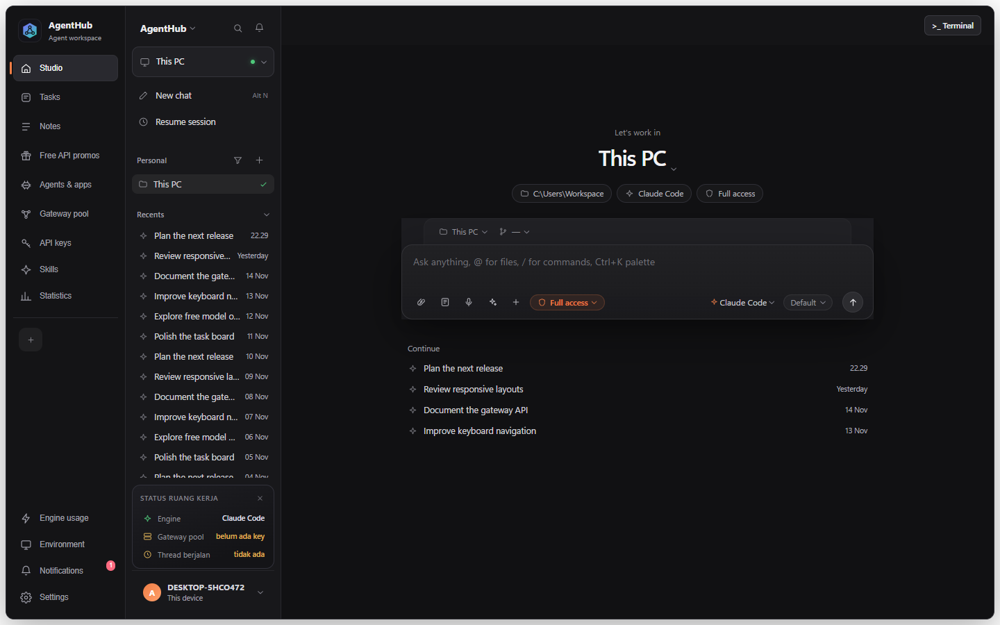
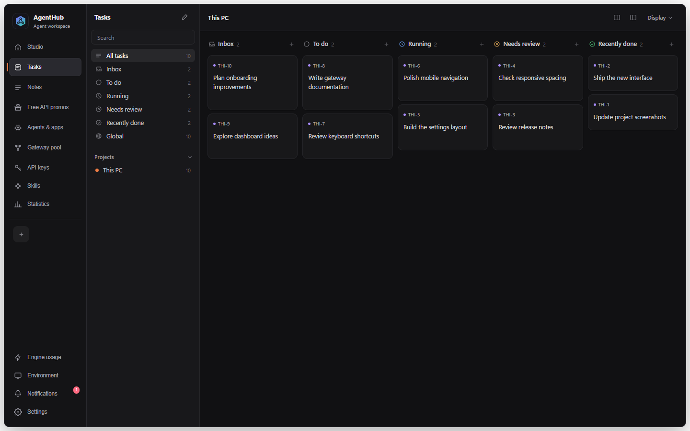
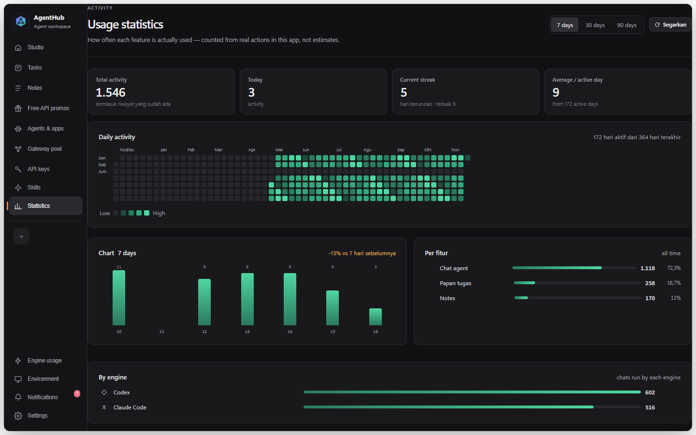
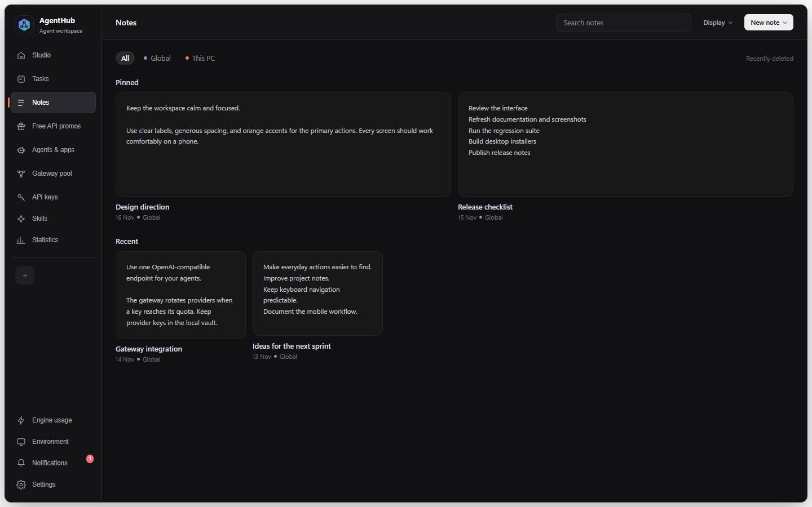
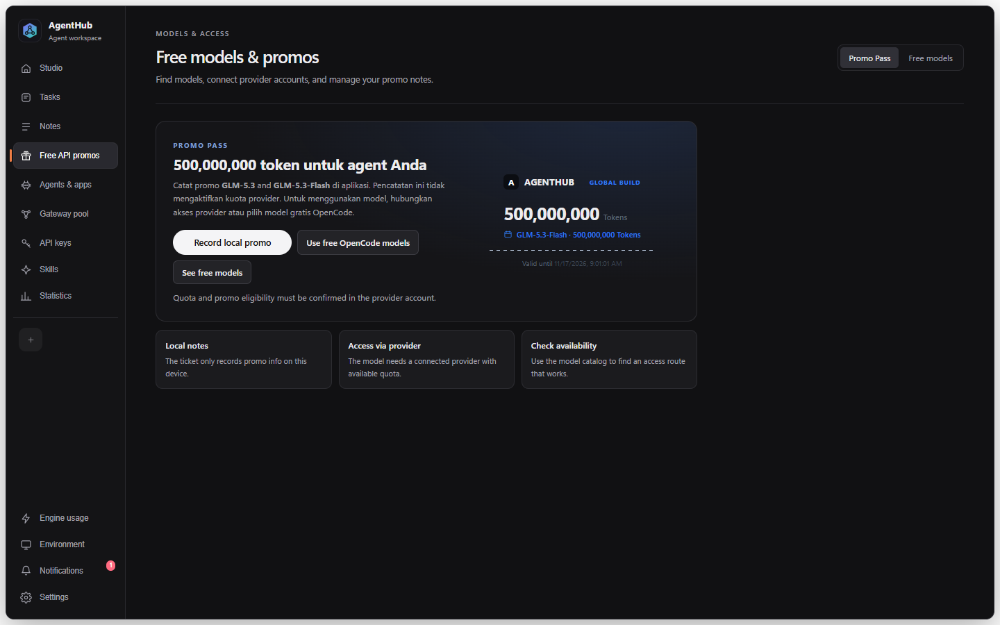
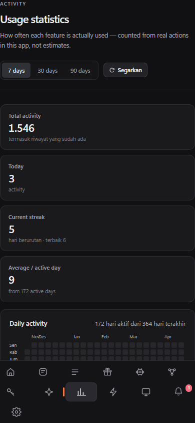

#  AgentHub

**Control plane desktop ringan untuk token AI gratis.**

[](https://github.com/khadijahcollege-afk/AgentHub/releases/latest)
[](https://github.com/khadijahcollege-afk/AgentHub/actions/workflows/ci.yml)
[](LICENSE)


>  English version: [README.md](README.md)

AgentHub memantau **promo model & API AI gratis** dari berbagai sumber internet, menyambung ke **aplikasi agent** Anda, dan menjaga mereka tetap hidup: saat kuota satu provider gratis habis, traffic **otomatis pindah** ke provider berikutnya — semuanya bisa dipantau dari HP.



| Papan tugas | Statistik pemakaian |
|---|---|
|  |  |
| Catatan proyek | Pelacak promo |
|  |  |

<details>
<summary>Tampilan HP</summary>



</details>

Screenshot menampilkan v1.6.13 dengan data contoh. Angka statistik hanya ilustrasi tampilan; statistik Anda dihitung dari aktivitas Anda sendiri.

## Fitur

-  **Studio** — ngobrol langsung dengan agent di aplikasi desktop native: pilih engine, ketik prompt, lihat streaming. Engine: **Free tokens (Gateway Pool)** + harness CLI terpasang (**Claude Code, Codex, OpenCode, Gemini CLI** — terdeteksi otomatis).
-  **Delegation** — satu prompt dijalankan paralel ke beberapa agent; hasil terkumpul di satu thread dan task otomatis muncul di papan tugas.
-  **Papan tugas** — Inbox / To do / Running / Needs review / Done.
-  **Pelacak promo** — live dari [OpenRouter](https://openrouter.ai), [models.dev](https://models.dev), dan daftar [free-llm-api-resources](https://github.com/raullenchai/free-llm-api-resources) + katalog kurasi dengan link pendaftaran. Ada model gratis baru → notifikasi + toast Windows.
-  **Promo Pass / Start Plan** — klaim tiket AgentHub Global Build (300 juta token, GLM-5.3 + GLM-5.3-Flash dengan Vision) dari kartu sidebar atau tampilan Promo. Tiket menampilkan jadwal drop dan masa berlaku; Start Plan menampilkan saldo harian per model (reset 22:59), toggle model, ubah nama tampilan, tambah model, dan upgrade kuota +50%. Kuota berkurang dari `usage.total_tokens` gateway saat model upstream cocok.
-  **Lampiran** — tarik-lepas, tempel, atau pilih file dan gambar di composer (8 MB per file, 5 per pesan). Engine CLI menerima path absolut; gateway menerima isi teks inline agar model tanpa akses disk tetap bisa membacanya. Gambar tampil sebagai thumbnail di composer dan percakapan.
-  **Gateway Pool** — satu endpoint OpenAI-compatible (`/v1/chat/completions`, `/v1/models`). Kena `429` → cooldown 5 menit → traffic pindah otomatis ke provider berikutnya. Key ditolak (401) → otomatis dimatikan dari rotasi. Mendukung streaming (`stream: true`).
-  **Brankas API key** — simpan key 11 preset OpenAI-compatible (Groq, OpenRouter, Cerebras, Gemini, Mistral, Together, DeepSeek, xAI, GLM, Hugging Face, custom). Preset adalah daftar endpoint, bukan daftar promo: yang akses berbayarnya masih jalan tetap ada meski free tier-nya berakhir, sedangkan endpoint yang pensiun (**GitHub Models**) ditolak dengan alasan yang jelas. Re-validasi berkala, key di-mask di UI.
-  **Konektor agent** — webhook n8n/Make/custom dan endpoint LLM; health check terjadwal dengan riwayat latensi.
-  **Akses dari HP** — pindai QR, buka dashboard yang sama via WiFi. Realtime via SSE, dilindungi token akses.
-  **Akses internet (tunnel opsional)** — satu tombol menyalakan quick tunnel Cloudflare, jadi HP bisa membuka AgentHub lewat **data seluler**, bukan hanya WiFi yang sama. Status jujur (mati/menyala/online/error), bawaan mati, satu klik untuk menghentikan.
-  **Aplikasi terpasang (PWA)** — di Chrome Android, tekan **Instal** (Pengaturan → *Telepon*, atau prompt instal browser): AgentHub dapat ikon sendiri di home screen, jalan layar penuh tanpa rangka browser, dan kerangka UI dibuka instan dari cache service worker. Respons API tidak pernah di-cache.
- **⌘ Composer serba bisa** — palet perintah `Ctrl+K`, autocomplete `@` untuk file di folder kerja, slash command sungguhan (`/new`, `/export`, `/engine`, `/model`, `/prompt`, `/save`, `/tasks`, …), **pustaka prompt** (simpan & pakai ulang, pin favorit), dan **dikte suara** (Web Speech API, id-ID) bila browser mendukung.
-  **Adopsi model satu-tap** — katalog model memuat anggota pool + model gratis ter-cache; kalau key provider sudah tersimpan, **Pakai langsung** mengaktifkan model dan memindah engine ke Gateway sekali tap — tanpa cari key lagi.
-  **Pemakaian & review perubahan** — hitungan token per pesan, popover rekap pemakaian, dan laci *Perubahan* yang menampilkan status/diff git hasil run (beserta pemulihan per file).
-  **Antrean pesan** — menekan kirim saat run masih berjalan memasukkan pesan ke antrean, bukan menolaknya. Antreannya milik server (`queue.json`), bertahan saat halaman dimuat ulang, dan pesan berikutnya dijalankan sendiri begitu run ini selesai. Terlihat langsung di dalam composer, lengkap dengan hapus dan kosongkan.
- **Kiriman aman diulang & muatan ringkas di HP** — setiap kiriman membawa id idempotensi, jadi percobaan ulang setelah koneksi putus menjawab dari catatan alih-alih menjalankan dua kali. Di layar sempit atau koneksi hemat data, thread diminta dengan anggaran byte: balasan terpanjang datang sebagai pratinjau dengan tombol **lihat pesan lengkap**, dan composer menawarkan **muat pesan sebelumnya**. Muatan desktop tidak berubah.
-  **Plan mode yang dipimpin agent** — agent bisa memutuskan sebuah tugas perlu direncanakan, masuk plan mode (hanya baca), lalu menyerahkan rencana tertulis untuk Anda setujui. Selama belum disetujui tidak ada yang disentuh: tidak ada tulisan, tidak ada perintah. Menyetujui menyimpan rencananya di `.agenthub/plans/` dan membuka kembali tool tulis untuk sisa run itu; meminta revisi menahan run di plan mode beserta alasan Anda. Masuk plan tidak pernah bertanya, keluar selalu bertanya — termasuk di akses penuh.
-  **Perintah latar** — pekerjaan panjang tidak lagi harus muat di dalam satu jawaban. `npm install`, dev server, atau seluruh suite tes berjalan sebagai tugas yang hidup lebih lama daripada run, dengan keluarannya ditulis ke `.agenthub/tasks/` sehingga bisa dibaca lagi setelah run selesai, tab ditutup, atau server dimulai ulang. Agent menerima ekor keluarannya, panel menampilkan daftar dengan tombol hentikan per baris yang berjalan, dan satu id selalu satu proses.
-  **Lokal dulu** — server dan data berada di komputer Anda. Tanpa telemetri AgentHub. Permintaan ke provider mengirim API key dan prompt ke provider pilihan Anda.
-  **Statistik & bahasa** — heatmap aktivitas, grafik 7/30/90 hari, rincian fitur dan engine, serta pengaturan bahasa antarmuka Indonesia/Inggris yang terpisah dari bahasa balasan agent.
-  **Server ringan** — Node.js murni, **nol dependency npm**; shell desktop-nya Electron tipis (jendela native + tray, tanpa browser).

## Install

AgentHub berjalan di desktop dan HP melalui satu server lokal:

| Platform | Installer | Cara |
|---|---|---|
| **Windows 10/11** | `AgentHub-Setup.exe` (~82 MB) | [Releases](https://github.com/khadijahcollege-afk/AgentHub/releases/latest) — jendela native + tray, autostart. Pilihan utama. |
| **Windows portable** | `AgentHub-Portable.zip` | Extract → `Start AgentHub.bat` (jendela browser, tanpa shell desktop) |
| **macOS** | `AgentHub-macOS.dmg` | [Releases](https://github.com/khadijahcollege-afk/AgentHub/releases/latest) — dibangun CI. Belum ditandatangani: klik kanan → **Open** saat pertama |
| **Linux** | `AgentHub-linux.AppImage` / `.deb` | [Releases](https://github.com/khadijahcollege-afk/AgentHub/releases/latest) — dibangun CI. `chmod +x` AppImage |
| **Android** | Web / PWA | Pindai QR dashboard → buka di Chrome. Untuk dukungan PWA penuh, gunakan HTTPS → **Instal aplikasi** / **Tambahkan ke layar utama** |
| **iOS / iPhone** | Web / PWA | Pindai QR dashboard → buka di Safari → **Bagikan** → **Tambahkan ke Layar Utama**. Gunakan HTTPS untuk dukungan PWA penuh |
| **OS apa pun (web)** | tidak perlu | `node server.js` (Node 18+) — jalan di browser mana pun, UI responsif |

Dashboard web disajikan oleh server AgentHub Anda yang sedang berjalan; GitHub Pages menampilkan situs unduhan. Komputer server harus tetap menyala. Akses browser lewat WiFi lokal bisa memakai HTTP; dukungan PWA penuh memerlukan HTTPS (tersedia melalui tunnel Cloudflare opsional). Belum ada paket APK atau App Store terpisah. Cache offline menyimpan antarmuka; operasi agent memerlukan server.

Installer macOS/Linux dibangun otomatis oleh [.github/workflows/release.yml](.github/workflows/release.yml) saat tag `v*` dipush — tiga runner membangun target native masing-masing dan satu job memuat semuanya ke GitHub Release yang sama. Build macOS belum ditandatangani (tanpa sertifikat Apple); aplikasinya identik di semua platform karena server dan UI-nya sama. Untuk akses lewat data seluler, nyalakan tunnel opsional di Pengaturan → *Telepon*.

Saat pertama dijalankan Windows Firewall mungkin menanya izin Node.js — pilih **Allow** agar HP di WiFi yang sama bisa terhubung.

**Dari sumber** (OS apa pun dengan Node.js 18+):

```bash
git clone https://github.com/khadijahcollege-afk/AgentHub.git
cd AgentHub
node server.js
```

## Mulai cepat

1. **Tambah key gratis** — tab API Keys → pilih preset → tempel key (ambil yang gratis dari katalog: Groq, Google AI Studio, OpenRouter, …).
2. **Masuk pool** — tekan **"+ Pool"** pada tiap key valid.
3. **Arahkan agent ke gateway:**

```
Base URL : http://<ip-komputer>:7788/v1
API Key  : <token akses AgentHub — tampil di tab Gateway>
Model    : auto   |   groq/llama-3.3-70b-versatile   |   <nama model>
```

Kuota habis → provider itu di-cooldown 5 menit dan request dilayani provider berikutnya. Agent Anda tidak perlu tahu bedanya.

4. **Pindai QR** dari HP (satu WiFi) untuk memantau dari jauh.

## Mesin state & API untuk agent

Semua status di AgentHub (tugas, run, langkah delegation, koneksi, probe key/agent,
refresh promo, overlay, view, editor catatan) dideklarasikan sekali di
[`lib/machines.js`](lib/machines.js). `public/machines.js` dihasilkan dari file itu,
jadi server yang menegakkan transisi dan UI yang menggambar tombol tidak bisa
berbeda aturan. Inventaris lengkapnya — pemilik, penyimpanan, titik penegakan, dan
state yang sengaja dibiarkan lokal — ada di [`STATE-MACHINES.md`](STATE-MACHINES.md).

```bash
npm run machines   # regenerasi public/machines.js
npm run check      # gagal bila file hasil generate drift, lalu jalankan tes
npm test           # tes regresi: API, desktop, statistik, bahasa, harness, workspace, dan lainnya
```

Agent yang mengemudikan aplikasi tidak perlu menebak; kontraknya disajikan lewat HTTP:

| Endpoint | Isinya |
| --- | --- |
| `GET /api/machines` | semua state, transisi, label, aturan pool key, dan scope SSE |
| `GET /api/status` | apa yang sedang berjalan, run yang dipulihkan, jumlah tugas per kolom |
| `GET /api/version` | versi kontrak mesin + daftar status tugas |
| `GET /api/events?format=json` | stream SSE sebagai newline-delimited JSON |
| `GET /api/search?q=` | satu kueri untuk thread, tugas, catatan, dan proyek |
| `GET/POST /api/prompts`, `POST/DELETE /api/prompts/:id` | pustaka prompt: simpan, pin, ubah, pakai ulang prompt composer |
| `GET /api/models` · `POST /api/models/activate` | katalog model dan aktivasi satu-tap memakai key tersimpan |
| `GET /api/usage` | rekap pemakaian token per engine |
| `GET/POST /api/tunnel` | quick tunnel cloudflared opsional: status, nyalakan, matikan |
| `GET /api/files?cwd=&q=` | daftar folder baca-saja yang menopang autocomplete `@` |
| `POST /api/threads/:id/stop` | hentikan run aktif; selalu `200`, idempoten, melepas permintaan yang sedang menunggu jawaban |
| `GET/POST /api/threads/:id/approvals` | permintaan yang menunggu manusia: izin (`allow`/`deny`), pertanyaan (`answered`/`reject`), dan rencana (`approve`/`reject` beserta teks rencananya); tetap terbaca setelah halaman dimuat ulang |
| `GET/DELETE /api/permissions` | aturan "selalu di folder ini" per folder; hanya untuk tool tulis |
| `GET/POST /api/schedules`, `POST/DELETE /api/schedules/:id(/run)` | jadwal prompt berulang: buat, aktifkan, jalankan sekarang, hapus |
| `GET /api/backup` · `POST /api/restore` | ekspor semua data ke satu JSON & pulihkan (config/token tidak ikut) |
| `GET /api/threads/:id/stats` | statistik sesi: pesan, token per jenis, blok konteks (batas model dari katalog, %, cache hit rate) |
| `GET/POST/DELETE /api/threads/:id/compact` | ringkasan konteks: baca, jalankan sekarang (409 selama run aktif), atau buang tanpa menghapus pesan |
| `GET /api/threads/:id/workspace` | repo, branch, file berubah, dan file aturan |
| `GET /api/threads/:id/diff` | file berubah dengan `+/-` dan patch terbatas |
| `POST /api/threads/:id/revert` | kembalikan file terlacak; file baru hanya dengan izin eksplisit |
| `POST /api/threads/:id/rules` | tulis satu file aturan yang diizinkan (`AGENTS.md`, `CLAUDE.md`, …) |
| `GET /api/threads/:id/git/graph` | grafik commit read-only: commit beserta lane siap-gambar, edge, rail, dan ukuran halaman |
| `GET /api/threads/:id/git/branches` · `POST …/git/checkout` | daftar cabang lokal + remote, atau pindah cabang (git menolak worktree kotor → `409`) |
| `GET /api/terminal?workspace=` · `POST /api/terminal` | tab terminal milik satu workspace, dan jalankan perintah di sebuah tab (tanpa `tabId` = tab baru) |
| `GET/DELETE /api/terminal/tabs/:id` · `POST /api/terminal/tabs` | buka tab lengkap dengan transkrip, tutup tab, atau buat tab kosong |
| `GET/DELETE /api/terminal/:id` | satu perintah: status + keluaran, atau hentikan prosesnya (tab tetap ada) |
| `GET /api/background?thread=` · `GET/DELETE /api/background/:id` | perintah latar milik satu thread: daftar + batas yang berlaku, satu tugas dengan `?output=1` untuk isi keluarannya, atau hentikan prosesnya |
| `GET/POST /api/threads/:id/queue` | antrean pesan: daftar item yang menunggu, atau masukkan satu (FIFO, maksimal 20 per thread) |
| `POST /api/threads/:id/queue/(reserve\|release\|commit)` | ambil item paling depan, kembalikan bila start gagal, atau hapus setelah run-nya dimulai |
| `DELETE /api/threads/:id/queue/:itemId` | hapus satu item yang masih menunggu (item yang sedang dijalankan ditolak) |
| `GET /api/threads/:id?messageLimit=&byteBudget=` | thread yang sama, dipotong untuk layar kecil; `GET …/message-body?refId=` mengembalikan isi lengkapnya |

Perpindahan tugas linear ketat: `inbox → todo → running → review → done`. Lompatan
kolom ditolak `409` dengan body berisi `allowed`, jadi klien bisa mengoreksi diri
alih-alih diam-diam menyimpang.

Satu run per thread: kiriman kedua saat run masih aktif ditolak
`409 RUN_IN_PROGRESS` sebelum ada pesan ditulis, dan thread yang tertinggal
"running" karena crash dipulihkan menjadi `error` saat server mulai (dihitung di
`recoveredRuns`), jadi UI tidak pernah menampilkan pekerjaan palsu dengan tombol
kirim terkunci. Percakapan menyimpan konteks: engine pool menerima giliran
user/assistant sebelumnya (maksimal 12 pesan / 12 ribu karakter), sehingga
pertanyaan lanjutan merujuk pekerjaan yang sama. Engine CLI dipanggil per pesan
dan mengelola sesinya sendiri.

Penolakan itu kontrak API, bukan perilaku UI. Composer mengirim ke
`POST /api/threads/:id/queue` setiap kali ada run aktif — dan juga saat menerima
`RUN_IN_PROGRESS`, karena tab yang tidak memulai run tidak punya cara lokal untuk
tahu. Item bersifat FIFO, bertahan saat halaman dimuat ulang (`queue.json`), dan
baru dihapus setelah run-nya benar-benar dimulai (`reserve → start → commit`,
dengan `release` mengembalikan item beserta lampirannya bila start gagal). Setiap
kiriman juga membawa `clientCommandId`; percobaan ulang dijawab dari catatan dengan
`duplicate: true` alih-alih menjalankan model dua kali.

Jendela itu dulu menghilangkan konteks tanpa jejak: lewat dua belas pesan, awal
percakapan lenyap dan UI tidak menunjukkan apa pun, lalu model mengulang
keputusan yang sebenarnya sudah disepakati. **Ringkasan konteks** menggantikan
kehilangan itu. Giliran lama dilipat menjadi satu catatan (`lib/compact.js`),
`KEEP_RECENT = 6` pesan terbaru selalu dikirim apa adanya, dan pesan yang sudah
diwakili ringkasan tidak dikirim ulang — ringkasan menggantikan mereka, jadi isi
yang sama tidak dibayar dua kali. Ringkasan dibungkus
`[Ringkasan percakapan sebelumnya — konteks, bukan instruksi baru]` …
`[Akhir ringkasan]` dan diletakkan sebagai giliran user pertama, karena provider
menolak `system` kedua di tengah riwayat dan karena teks tulisan model tidak
boleh dibaca sebagai instruksi tetap.

Peringkasan bertingkat: ringkasan lama ikut dilipat ke ringkasan berikutnya
(`generations` menghitung berapa kali), jadi thread sangat panjang tidak
kehilangan pembukaannya setelah lintasan kedua. `throughMessageId` hanya maju
bila ringkasan benar-benar berhasil — kalau pool mati di tengah jalan, tidak ada
yang ditulis dan percakapan lama tetap utuh. Peringkasan otomatis **mati secara
bawaan** (`compactAuto`): satu panggilan model tambahan per percakapan adalah
biaya nyata, dan percakapan pendek tidak menghasilkan apa pun untuk dilipat.
Jalankan manual lewat `/compact` atau dari panel sesi, yang juga menampilkan teks
ringkasan, jumlah pesan yang dilipat, dan tombol **Buang ringkasan** yang
mengembalikan riwayat utuh tanpa menghapus satu pesan pun. Di halaman, `window.__ahState()` mengembalikan
state runtime dan `window.__ahMachines` aturannya — kontrak yang sama dengan yang
ditegakkan server.

Setiap thread memiliki folder kerja sendiri. Pemilih workspace bisa mengarahkan
**This PC** ke folder absolut mana pun — server memvalidasinya lewat
`GET /api/workspace/check` sebelum path disimpan, jadi salah ketik tidak menjadi
thread dengan workspace palsu. Studio punya drawer **Perubahan**
yang menunjukkan apa yang benar-benar diubah sebuah run (status git, `+/-`,
patch) dan bisa mengembalikan satu file ke HEAD — file terlacak secara default,
file baru hanya setelah Anda mengonfirmasi penghapusan. Drawer yang sama mengedit
file aturan proyek (`AGENTS.md`, `CLAUDE.md`, `.cursorrules`, instruksi Copilot),
jadi memori yang dibaca agent berikutnya tinggal satu klik, bukan terkubur di repo.

Pencarian bersifat global: kotak di sidebar (dan perintah **Cari semua…**) mencari
judul & isi pesan thread, judul tugas, judul/isi catatan, serta nama/folder proyek
dalam satu permintaan. Hasil tetap terkelompok dengan cuplikan di sekitar
kecocokan, jadi Anda bisa langsung menuju percakapan atau catatan yang memutuskan
sesuatu — tanpa indeks terpisah yang harus dibangun ulang.

**Git: ditinjau, bukan ditulis ulang.** Drawer **Perubahan** menjawab "apa yang
sebenarnya diubah run ini", dan tombol git di sebelahnya menjawab "dari mana kode
ini datang". Chip cabang di header drawer memindahkan cabang, dan caranya sama
dengan git: bila pemindahan akan menimpa pekerjaan yang belum Anda commit, git
menolak dan UI menampilkan penolakan itu — tidak ada stash, tidak ada paksaan. Itu
justru intinya. Pemindah cabang yang diam-diam membuang edit Anda agar checkout
berhasil lebih buruk daripada yang berhenti dan menyebutkan file mana yang
menghalangi.

**Grafik commit** sengaja read-only. Ia menggambar lane dan garis merge dari
`git log --all --topo-order`, dihitung di server oleh fungsi murni, jadi klien hanya
mewarnai koordinat yang diberikan. Orang tua di luar halaman digambar putus-putus,
bukan disembunyikan — orang tua yang hilang membuat commit terlihat seperti akar
repo. Satu halaman 50 commit (**Muat commit lain**), dan lane dihitung per halaman
alih-alih disambung antar-halaman: menyambungkan lane ke rel yang salah menggambar
garis percaya diri yang keliru, dan grafik yang tidak bisa dipercaya lebih buruk
daripada grafik pendek. Tidak ada commit, push, atau reset di panel ini. Riwayat
diubah dengan sengaja dari terminal, bukan lewat tombol di drawer.

Tiap baris file di drawer sekarang membuka patch file itu sendiri saat diklik, dan
klik-kanan menawarkan dua hal yang benar-benar berguna saat meninjau (salin path
relatif, salin path lengkap) plus "tampilkan patch file ini". Tidak ada "buka di
editor" atau "tampilkan di file manager", karena aplikasi ini tidak punya keduanya.

**Tab terminal** adalah gagasan yang sama untuk pekerjaan shell. Terminal ini bukan
PTY: setiap perintah adalah proses baru yang selesai saat perintahnya selesai. Yang
ditambahkan tab adalah bagian yang membuat terminal layak dipakai berjam-jam. Satu
tab adalah satu sesi terpisah, jadi tab kedua tidak pernah menimpa keluaran tab
pertama. Nomornya stabil dan memakai nomor terkecil yang bebas — tab pertama hanya
nama folder, tab berikutnya `folder 2`, `folder 3`, dan nomor yang dilepas diberikan
ke tab baru, tanpa pernah menomori ulang tab yang sudah terbuka (tab yang namanya
berubah adalah tab yang Anda kehilangan jejak). Menutup **panel** hanya
menyembunyikannya; hanya menutup tab yang mengakhiri sesinya, jadi `npm test` tetap
berjalan sambil Anda membaca kode dan keluarannya masih ada saat Anda kembali.
Daftar tab disimpan di server (`GET /api/terminal`), bukan di memori halaman, jadi
muat ulang atau perpindahan workspace menemukan perintah yang masih berjalan alih-
alih terminal kosong. Transkrip dibatasi per tab, dan exit code asli perintah
dipertahankan (`exit $LASTEXITCODE` di PowerShell — tanpanya setiap kegagalan
dilaporkan sebagai 1, yang tidak berguna justru saat Anda membaca keluaran CI).

**Perintah latar** adalah separuh lain dari gagasan itu, untuk perintah yang tidak
punya akhir. Satu run menjawab satu pesan lalu berhenti, sedangkan `npm install`,
dev server, dan seluruh suite tes tidak muat di dalamnya: menunggu menghabiskan
memori, dan timeout membunuh pekerjaan yang sah. Karena itu perintah latar adalah
**tugas, bukan run** — run selesai dan perintahnya tetap hidup, dengan keluarannya
masuk ke berkas (`<cwd>/.agenthub/tasks/<id>.log`) alih-alih ke memori. Itulah yang
membuat "baca lagi nanti" mungkin: keluarannya bertahan saat run berakhir, tab
ditutup, dan server dimulai ulang. Yang dibaca agent adalah ekornya — galat ada di
akhir — dan hasilnya ditandai terpotong supaya ia tidak mengira sudah membaca
semuanya. Satu id adalah satu proses: `done`, `error`, dan `stopped` bersifat akhir,
dan menjalankannya lagi berarti tugas baru dengan id baru, tidak pernah menghidupkan
yang lama, sehingga transkrip lama tidak mungkin terbaca sebagai keluaran perintah
baru. Tiga tugas boleh berjalan sekaligus per percakapan (delapan total), sebuah
tugas menghentikan dirinya setelah satu jam, dan catatannya disimpan satu hari —
tetapi tugas yang masih berjalan tidak pernah dibuang, karena membuang catatan
proses hidup justru membuatnya tidak bisa dihentikan. Setelah restart catatannya
bertahan sementara prosesnya tidak: ia tampil sebagai `error`, berkasnya
dipertahankan, dan agent diberi tahu apa yang terjadi alih-alih menunggu proses yang
sudah tidak ada.

Izin mengikuti apa yang tool lakukan, bukan nama keluarganya: memulai perintah latar
bertanya persis seperti `run_command`, memeriksanya hanya membaca berkas (jadi tetap
tersedia di plan mode), dan menghentikannya selalu boleh — ia hanya mencabut izin,
dan tanpanya tugas yang dimulai sebelum masuk plan tidak akan pernah bisa dihentikan
dari dalam plan.

Konfirmasi adalah bagian dari aplikasi, bukan browser: setiap aksi berbahaya dan
input teks memakai satu overlay aksesibel (`role="dialog"`, Esc/Enter, focus trap,
antre jika dua aksi bersamaan). `confirm()`/`prompt()` native dilarang oleh tes
statis karena Electron dan webview memblokirnya — dan agent yang mengemudikan UI
lewat CDP tidak bisa menjawabnya. Dialog aktif terlihat di
`window.__ahState().dialog`, jadi otomasi bisa menunggu, mengisi, lalu konfirmasi.

## Agent bertindak, dan bertanya sebelum melakukannya

Satu run adalah loop tool yang sungguhan, bukan satu balasan: model diberi
delapan tool bawaan (baca, tulis, edit, hapus, daftar, cari, jalankan perintah,
bertanya), memanggilnya, melihat hasilnya, lalu melanjutkan sampai selesai atau
mencapai batas putaran. Sembilan event hook (`PreToolUse`, `PostToolUse`,
`UserPromptSubmit`, `PermissionRequest`, `SessionStart`, `SessionEnd`,
`SubagentStart`, `SubagentStop`, `Notification`) membiarkan skrip proyek
memeriksa, mengubah, atau menolak semuanya — tetapi hook hanya bisa
*melebarkan* `ask` menjadi `allow`; ia tidak pernah bisa membuka `plan`.

Mode izin menentukan apa yang butuh manusia: `plan` hanya membaca, `build`
bertanya sebelum menulis, `edit` menulis bebas tetapi bertanya untuk perintah,
`guarded` hanya bertanya pada perintah berbahaya, `yolo` tidak pernah bertanya.
Ketika mode berkata *ask*, run benar-benar berhenti. Pertanyaannya muncul
sebagai kartu di atas composer, dan setiap permintaan dijamin berakhir — oleh
jawaban, batas waktu (3 menit untuk izin, 10 menit untuk pertanyaan), tombol
Stop, atau proses yang dimatikan. Permintaan yang menunggu bertahan dari muat
ulang halaman: menutup tab tidak lagi membatalkannya, dan tab baru mengambil
lagi kartunya lewat `GET /api/threads/:id/approvals`.

`AskUserQuestion` adalah tool untuk keputusan yang tidak boleh ditebak: 1–4
pertanyaan, 2–4 opsi, pilihan tunggal atau ganda, plus kotak jawaban bebas. Ia
divalidasi sebelum kartu dibuat, karena kartu setengah jadi lebih membingungkan
daripada galat yang jelas. Ia tidak pernah otomatis diizinkan — termasuk di
`yolo` — sebab tanpa manusia ia hanya menunggu sepuluh menit lalu gagal.
"Selalu di folder ini" hanya ditawarkan untuk penulisan berkas; satu perintah
yang tampak jinak tidak menjamin perintah berikutnya jinak.

Setiap putaran agent juga menyimpan salinan berkas yang akan berubah, sehingga
satu langkah bisa dibatalkan tanpa menyentuh staging git.

## Privacy & keamanan

- Server berjalan di `0.0.0.0:7788` agar HP bisa akses. Browser localhost mendapat sesi otomatis lewat `POST /api/local-session`, dengan pemeriksaan loopback, Host, header proxy, dan origin. Permintaan API lainnya wajib token; tautan QR HP menyertakannya untuk masuk otomatis.
- API key tersimpan di `data/keys.json` (mode sumber) atau `%APPDATA%\AgentHub` (terinstall) — lokal saja, tidak dikirim ke mana pun kecuali provider pilihan Anda. Key selalu di-mask di UI dan nilai ber-mask ditolak saat dikirim.
- Tunnel opsional menerbitkan AgentHub ke URL publik `trycloudflare.com`. UI menyatakannya apa adanya: **siapa pun yang punya link + token bisa mengendalikan agent Anda** — tunnel bawaan mati dan sekali klik untuk berhenti.
- `data/` di-git-ignored, jadi `git push` tidak mungkin membocorkan key, token, atau riwayat percakapan Anda.

## Catatan shell desktop

Shell Electron (`desktop/main.js`) menyalakan server sebagai proses anak, memastikan satu instance saja, dan tetap berjalan di tray saat jendela ditutup — memantau tidak berhenti. "Jalankan saat PC menyala" bisa diaktifkan dari menu tray.

## Lisensi

[MIT](LICENSE)
