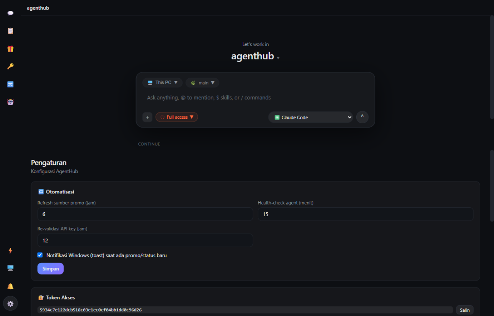
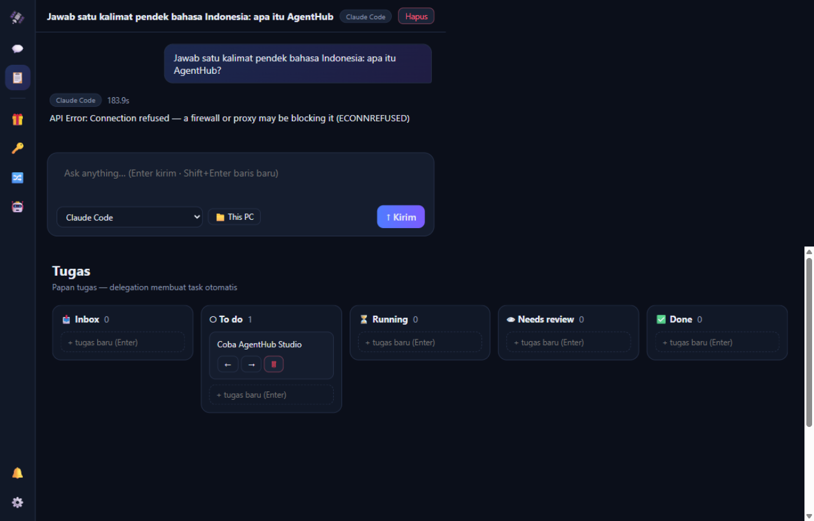
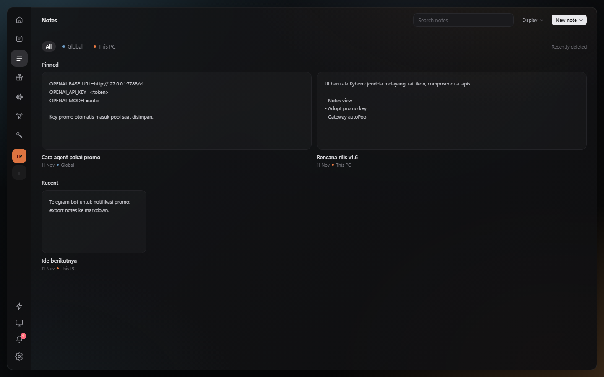
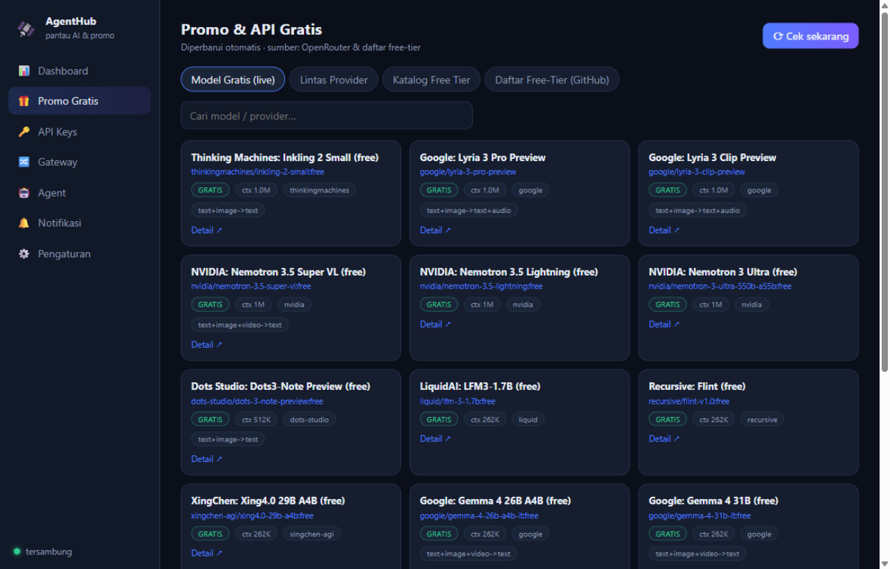

#  AgentHub

**Control plane desktop ringan untuk token AI gratis.**

[](https://github.com/khadijahcollege-afk/AgentHub/releases/latest)
[](https://github.com/khadijahcollege-afk/AgentHub/actions/workflows/ci.yml)
[](LICENSE)


>  English version: [README.md](README.md)

AgentHub memantau **promo model & API AI gratis** dari berbagai sumber internet, menyambung ke **aplikasi agent** Anda, dan menjaga mereka tetap hidup: saat kuota satu provider gratis habis, traffic **otomatis pindah** ke provider berikutnya — semuanya bisa dipantau dari HP.

| Studio (chat) | Papan tugas | Catatan | Pelacak promo |
|---|---|---|---|
|  |  |  |  |

## Fitur

-  **Studio** — ngobrol langsung dengan agent di aplikasi desktop native: pilih engine, ketik prompt, lihat streaming. Engine: **Free tokens (Gateway Pool)** + harness CLI terpasang (**Claude Code, Codex, OpenCode, Gemini CLI** — terdeteksi otomatis).
-  **Delegation** — satu prompt dijalankan paralel ke beberapa agent; hasil terkumpul di satu thread dan task otomatis muncul di papan tugas.
-  **Papan tugas** — Inbox / To do / Running / Needs review / Done.
-  **Pelacak promo** — live dari [OpenRouter](https://openrouter.ai), [models.dev](https://models.dev), dan daftar [free-llm-api-resources](https://github.com/raullenchai/free-llm-api-resources) + katalog kurasi dengan link pendaftaran. Ada model gratis baru → notifikasi + toast Windows.
-  **Promo Pass / Start Plan** — klaim tiket AgentHub Global Build (300 juta token, GLM-5.3 + GLM-5.3-Flash dengan Vision) dari kartu sidebar atau tampilan Promo. Tiket menampilkan jadwal drop dan masa berlaku; Start Plan menampilkan saldo harian per model (reset 22:59), toggle model, ubah nama tampilan, tambah model, dan upgrade kuota +50%. Kuota berkurang dari `usage.total_tokens` gateway saat model upstream cocok.
-  **Lampiran** — tarik-lepas, tempel, atau pilih file dan gambar di composer (8 MB per file, 5 per pesan). Engine CLI menerima path absolut; gateway menerima isi teks inline agar model tanpa akses disk tetap bisa membacanya. Gambar tampil sebagai thumbnail di composer dan percakapan.
-  **Gateway Pool** — satu endpoint OpenAI-compatible (`/v1/chat/completions`, `/v1/models`). Kena `429` → cooldown 5 menit → traffic pindah otomatis ke provider berikutnya. Key ditolak (401) → otomatis dimatikan dari rotasi. Mendukung streaming (`stream: true`).
-  **Brankas API key** — simpan key 11+ preset (Groq, OpenRouter, Cerebras, Gemini, GitHub Models, Mistral, Together, DeepSeek, xAI, GLM, Hugging Face, custom). Re-validasi berkala, key di-mask di UI.
-  **Konektor agent** — webhook n8n/Make/custom dan endpoint LLM; health check terjadwal dengan riwayat latensi.
-  **Akses dari HP** — pindai QR, buka dashboard yang sama via WiFi. Realtime via SSE, dilindungi token akses.
-  **Akses internet (tunnel opsional)** — satu tombol menyalakan quick tunnel Cloudflare, jadi HP bisa membuka AgentHub lewat **data seluler**, bukan hanya WiFi yang sama. Status jujur (mati/menyala/online/error), bawaan mati, satu klik untuk menghentikan.
-  **Aplikasi terpasang (PWA)** — di Chrome Android, tekan **Instal** (Pengaturan → *Telepon*, atau prompt instal browser): AgentHub dapat ikon sendiri di home screen, jalan layar penuh tanpa rangka browser, dan kerangka UI dibuka instan dari cache service worker. Respons API tidak pernah di-cache.
- **⌘ Composer serba bisa** — palet perintah `Ctrl+K`, autocomplete `@` untuk file di folder kerja, slash command sungguhan (`/new`, `/export`, `/engine`, `/model`, `/prompt`, `/save`, `/tasks`, …), **pustaka prompt** (simpan & pakai ulang, pin favorit), dan **dikte suara** (Web Speech API, id-ID) bila browser mendukung.
-  **Adopsi model satu-tap** — katalog model memuat anggota pool + model gratis ter-cache; kalau key provider sudah tersimpan, **Pakai langsung** mengaktifkan model dan memindah engine ke Gateway sekali tap — tanpa cari key lagi.
-  **Pemakaian & review perubahan** — hitungan token per pesan, popover rekap pemakaian, dan laci *Perubahan* yang menampilkan status/diff git hasil run (beserta pemulihan per file).
-  **Lokal dulu** — semua berjalan di komputer Anda. Tanpa cloud, tanpa telemetri. API key tidak keluar dari disk.
-  **Server ringan** — Node.js murni, **nol dependency npm**; shell desktop-nya Electron tipis (jendela native + tray, tanpa browser).

## Install

AgentHub jalan di semua perangkat Anda — satu server lokal, lima cara pasang:

| Platform | Installer | Cara |
|---|---|---|
| **Windows 10/11** | `AgentHub-Setup.exe` (~82 MB) | [Releases](https://github.com/khadijahcollege-afk/AgentHub/releases/latest) — jendela native + tray, autostart. Pilihan utama. |
| **Windows portable** | `AgentHub-Portable.zip` | Extract → `Start AgentHub.bat` (jendela browser, tanpa shell desktop) |
| **macOS** | `AgentHub-macOS.dmg` | [Releases](https://github.com/khadijahcollege-afk/AgentHub/releases/latest) — dibangun CI. Belum ditandatangani: klik kanan → **Open** saat pertama |
| **Linux** | `AgentHub-linux.AppImage` / `.deb` | [Releases](https://github.com/khadijahcollege-afk/AgentHub/releases/latest) — dibangun CI. `chmod +x` AppImage |
| **Android** | PWA (web app terpasang) | Buka dashboard di Chrome → **Instal** — ikon di home screen, layar penuh, kerangka offline |
| **iOS / iPhone** | PWA | Buka dashboard di Safari → **Bagikan** → **Tambahkan ke Layar Utama** |
| **OS apa pun (web)** | tidak perlu | `node server.js` (Node 18+) — jalan di browser mana pun, UI responsif |

Installer macOS/Linux dibangun otomatis oleh [.github/workflows/release.yml](.github/workflows/release.yml) saat tag `v*` dipush — tiga runner membangun target native masing-masing dan satu job memuat semuanya ke GitHub Release yang sama. Build macOS belum ditandatangani (tanpa sertifikat Apple); aplikasinya identik di semua platform karena server dan UI-nya sama. Untuk akses lewat data seluler, nyalakan tunnel opsional di Pengaturan → *Telepon*.

Saat pertama dijalankan Windows Firewall mungkin menanya izin Node.js — pilih **Allow** agar HP di WiFi yang sama bisa terhubung.

**Dari sumber** (OS apa pun dengan Node.js 18+):

```bash
git clone https://github.com/khadijahcollege-afk/AgentHub.git
cd AgentHub
node server.js
```

## Mulai cepat

1. **Tambah key gratis** — tab API Keys → pilih preset → tempel key (ambil gratis dari katalog: Groq, OpenRouter, Cerebras, …).
2. **Masuk pool** — tekan **"+ Pool"** pada tiap key valid.
3. **Arahkan agent ke gateway:**

```
Base URL : http://<ip-komputer>:7788/v1
API Key  : <token akses AgentHub — tampil di tab Gateway>
Model    : auto   |   groq/llama-3.3-70b-versatile   |   <nama model>
```

Kuota habis → provider itu di-cooldown 5 menit dan request dilayani provider berikutnya. Agent Anda tidak perlu tahu bedanya.

4. **Pindai QR** dari HP (satu WiFi) untuk memantau dari jauh.

## Mesin state & API untuk agent

Semua status di AgentHub (tugas, run, langkah delegation, koneksi, probe key/agent,
refresh promo, overlay, view, editor catatan) dideklarasikan sekali di
[`lib/machines.js`](lib/machines.js). `public/machines.js` dihasilkan dari file itu,
jadi server yang menegakkan transisi dan UI yang menggambar tombol tidak bisa
berbeda aturan. Inventaris lengkapnya — pemilik, penyimpanan, titik penegakan, dan
state yang sengaja dibiarkan lokal — ada di [`STATE-MACHINES.md`](STATE-MACHINES.md).

```bash
npm run machines   # regenerasi public/machines.js
npm run check      # gagal bila file hasil generate drift, lalu jalankan tes
npm test           # 114 tes: mesin, kontrak HTTP, run + stop, pemulihan, workspace, pencarian, riwayat, promo pass, lampiran, prompt, PWA, jadwal, cadangan
```

Agent yang mengemudikan aplikasi tidak perlu menebak; kontraknya disajikan lewat HTTP:

| Endpoint | Isinya |
| --- | --- |
| `GET /api/machines` | semua state, transisi, label, aturan pool key, dan scope SSE |
| `GET /api/status` | apa yang sedang berjalan, run yang dipulihkan, jumlah tugas per kolom |
| `GET /api/version` | versi kontrak mesin + daftar status tugas |
| `GET /api/events?format=json` | stream SSE sebagai newline-delimited JSON |
| `GET /api/search?q=` | satu kueri untuk thread, tugas, catatan, dan proyek |
| `GET/POST /api/prompts`, `POST/DELETE /api/prompts/:id` | pustaka prompt: simpan, pin, ubah, pakai ulang prompt composer |
| `GET /api/models` · `POST /api/models/activate` | katalog model dan aktivasi satu-tap memakai key tersimpan |
| `GET /api/usage` | rekap pemakaian token per engine |
| `GET/POST /api/tunnel` | quick tunnel cloudflared opsional: status, nyalakan, matikan |
| `GET /api/files?cwd=&q=` | daftar folder baca-saja yang menopang autocomplete `@` |
| `POST /api/threads/:id/stop` | hentikan run aktif; selalu `200`, idempoten |
| `GET/POST /api/schedules`, `POST/DELETE /api/schedules/:id(/run)` | jadwal prompt berulang: buat, aktifkan, jalankan sekarang, hapus |
| `GET /api/backup` · `POST /api/restore` | ekspor semua data ke satu JSON & pulihkan (config/token tidak ikut) |
| `GET /api/threads/:id/stats` | statistik sesi: pesan, token per jenis, blok konteks (batas model dari katalog, %, cache hit rate) |
| `GET /api/threads/:id/workspace` | repo, branch, file berubah, dan file aturan |
| `GET /api/threads/:id/diff` | file berubah dengan `+/-` dan patch terbatas |
| `POST /api/threads/:id/revert` | kembalikan file terlacak; file baru hanya dengan izin eksplisit |
| `POST /api/threads/:id/rules` | tulis satu file aturan yang diizinkan (`AGENTS.md`, `CLAUDE.md`, …) |

Perpindahan tugas linear ketat: `inbox → todo → running → review → done`. Lompatan
kolom ditolak `409` dengan body berisi `allowed`, jadi klien bisa mengoreksi diri
alih-alih diam-diam menyimpang.

Satu run per thread: kiriman kedua saat run masih aktif ditolak
`409 RUN_IN_PROGRESS` sebelum ada pesan ditulis, dan thread yang tertinggal
"running" karena crash dipulihkan menjadi `error` saat server mulai (dihitung di
`recoveredRuns`), jadi UI tidak pernah menampilkan pekerjaan palsu dengan tombol
kirim terkunci. Percakapan menyimpan konteks: engine pool menerima giliran
user/assistant sebelumnya (maksimal 12 pesan / 12 ribu karakter), sehingga
pertanyaan lanjutan merujuk pekerjaan yang sama. Engine CLI dipanggil per pesan
dan mengelola sesinya sendiri. Di halaman, `window.__ahState()` mengembalikan
state runtime dan `window.__ahMachines` aturannya — kontrak yang sama dengan yang
ditegakkan server.

Setiap thread memiliki folder kerja sendiri. Pemilih workspace bisa mengarahkan
**This PC** ke folder absolut mana pun — server memvalidasinya lewat
`GET /api/workspace/check` sebelum path disimpan, jadi salah ketik tidak menjadi
thread dengan workspace palsu. Studio punya drawer **Perubahan**
yang menunjukkan apa yang benar-benar diubah sebuah run (status git, `+/-`,
patch) dan bisa mengembalikan satu file ke HEAD — file terlacak secara default,
file baru hanya setelah Anda mengonfirmasi penghapusan. Drawer yang sama mengedit
file aturan proyek (`AGENTS.md`, `CLAUDE.md`, `.cursorrules`, instruksi Copilot),
jadi memori yang dibaca agent berikutnya tinggal satu klik, bukan terkubur di repo.

Pencarian bersifat global: kotak di sidebar (dan perintah **Cari semua…**) mencari
judul & isi pesan thread, judul tugas, judul/isi catatan, serta nama/folder proyek
dalam satu permintaan. Hasil tetap terkelompok dengan cuplikan di sekitar
kecocokan, jadi Anda bisa langsung menuju percakapan atau catatan yang memutuskan
sesuatu — tanpa indeks terpisah yang harus dibangun ulang.

Konfirmasi adalah bagian dari aplikasi, bukan browser: setiap aksi berbahaya dan
input teks memakai satu overlay aksesibel (`role="dialog"`, Esc/Enter, focus trap,
antre jika dua aksi bersamaan). `confirm()`/`prompt()` native dilarang oleh tes
statis karena Electron dan webview memblokirnya — dan agent yang mengemudikan UI
lewat CDP tidak bisa menjawabnya. Dialog aktif terlihat di
`window.__ahState().dialog`, jadi otomasi bisa menunggu, mengisi, lalu konfirmasi.

## Privacy & keamanan

- Server berjalan di `0.0.0.0:7788` agar HP bisa akses; semua `/api/*` wajib token akses (tampil di Pengaturan, bisa di-regenerate). Kerangka UI sendiri terbuka tapi tanpa rahasia — gerbang token muncul sebelum data apa pun dimuat.
- API key tersimpan di `data/keys.json` (mode sumber) atau `%APPDATA%\AgentHub` (terinstall) — lokal saja, tidak dikirim ke mana pun kecuali provider pilihan Anda. Key selalu di-mask di UI dan nilai ber-mask ditolak saat dikirim.
- Tunnel opsional menerbitkan AgentHub ke URL publik `trycloudflare.com`. UI menyatakannya apa adanya: **siapa pun yang punya link + token bisa mengendalikan agent Anda** — tunnel bawaan mati dan sekali klik untuk berhenti.
- `data/` di-git-ignored, jadi `git push` tidak mungkin membocorkan key, token, atau riwayat percakapan Anda.

## Catatan shell desktop

Shell Electron (`desktop/main.js`) menyalakan server sebagai proses anak, memastikan satu instance saja, dan tetap berjalan di tray saat jendela ditutup — memantau tidak berhenti. "Jalankan saat PC menyala" bisa diaktifkan dari menu tray.

## Lisensi

[MIT](LICENSE)
