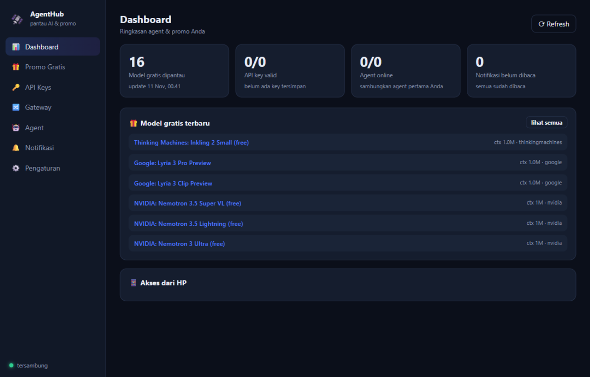
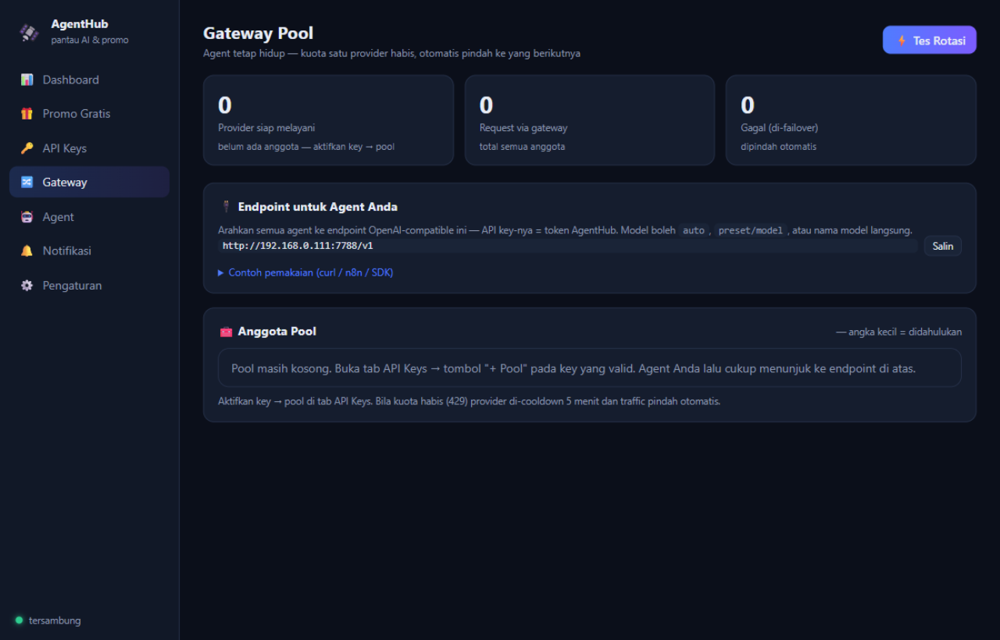

# 🛰️ AgentHub

**Control plane desktop ringan untuk token AI gratis.**

[](https://github.com/khadijahcollege-afk/AgentHub/releases/latest)
[](https://github.com/khadijahcollege-afk/AgentHub/actions/workflows/ci.yml)
[](LICENSE)


> 📖 English version: [README.md](README.md)

AgentHub memantau **promo model & API AI gratis** dari berbagai sumber internet, menyambung ke **aplikasi agent** Anda, dan menjaga mereka tetap hidup: saat kuota satu provider gratis habis, traffic **otomatis pindah** ke provider berikutnya — semuanya bisa dipantau dari HP.

| Dashboard | Pelacak promo | Gateway Pool |
|---|---|---|
|  |  |  |

## Fitur

- **🎁 Pelacak promo** — live dari [OpenRouter](https://openrouter.ai), [models.dev](https://models.dev), dan daftar [free-llm-api-resources](https://github.com/raullenchai/free-llm-api-resources) + katalog kurasi dengan link pendaftaran. Ada model gratis baru → notifikasi + toast Windows.
- **🔀 Gateway Pool** — satu endpoint OpenAI-compatible (`/v1/chat/completions`, `/v1/models`). Kena `429` → cooldown 5 menit → traffic pindah otomatis ke provider berikutnya. Key ditolak (401) → otomatis dimatikan dari rotasi. Mendukung streaming (`stream: true`).
- **🔑 Brankas API key** — simpan key 11+ preset (Groq, OpenRouter, Cerebras, Gemini, GitHub Models, Mistral, Together, DeepSeek, xAI, GLM, Hugging Face, custom). Re-validasi berkala, key di-mask di UI.
- **🤖 Konektor agent** — webhook n8n/Make/custom dan endpoint LLM; health check terjadwal dengan riwayat latensi.
- **📱 Akses dari HP** — pindai QR, buka dashboard yang sama via WiFi. Realtime via SSE, dilindungi token akses.
- **🔒 Lokal dulu** — semua berjalan di komputer Anda. Tanpa cloud, tanpa telemetri. API key tidak keluar dari disk.
- **🪶 Ringan** — Node.js murni, **nol dependency npm**, tanpa Electron.

## Install

**Windows 10/11 (64-bit)** — ambil terbaru dari [Releases](https://github.com/khadijahcollege-afk/AgentHub/releases/latest):

| Berkas | Keterangan |
|---|---|
| [`AgentHub-Setup.exe`](https://github.com/khadijahcollege-afk/AgentHub/releases/latest/download/AgentHub-Setup.exe) | Installer (~23 MB) — runtime Node.js sudah digabung, shortcut Start Menu, autostart opsional, uninstaller |
| [`AgentHub-Portable.zip`](https://github.com/khadijahcollege-afk/AgentHub/releases/latest/download/AgentHub-Portable.zip) | Portable — extract lalu jalankan `Start AgentHub.bat` |

Saat pertama dijalankan Windows Firewall mungkin menanya izin Node.js — pilih **Allow** agar HP di WiFi yang sama bisa terhubung.

**Dari sumber** (OS apa pun dengan Node.js 18+ — UI responsif, jalan di browser mana pun):

```bash
git clone https://github.com/khadijahcollege-afk/AgentHub.git
cd AgentHub
node server.js
```

## Mulai cepat

1. **Tambah key gratis** — tab API Keys → pilih preset → tempel key (ambil gratis dari katalog: Groq, OpenRouter, Cerebras, …).
2. **Masuk pool** — tekan **"+ Pool"** pada tiap key valid.
3. **Arahkan agent ke gateway:**

```
Base URL : http://<ip-komputer>:7788/v1
API Key  : <token akses AgentHub — tampil di tab Gateway>
Model    : auto   |   groq/llama-3.3-70b-versatile   |   <nama model>
```

Kuota habis → provider itu di-cooldown 5 menit dan request dilayani provider berikutnya. Agent Anda tidak perlu tahu bedanya.

4. **Pindai QR** dari HP (satu WiFi) untuk memantau dari jauh.

## Privacy & keamanan

- Server berjalan di `0.0.0.0:7788` agar HP bisa akses; semua `/api/*` wajib token akses (tampil di Pengaturan, bisa di-regenerate).
- API key tersimpan di `data/keys.json` (mode sumber) atau `%APPDATA%\AgentHub` (terinstall) — lokal saja.
- Akses dari luar rumah: pakai VPN seperti Tailscale — jangan port-forward langsung.

## Lisensi

[MIT](LICENSE)
