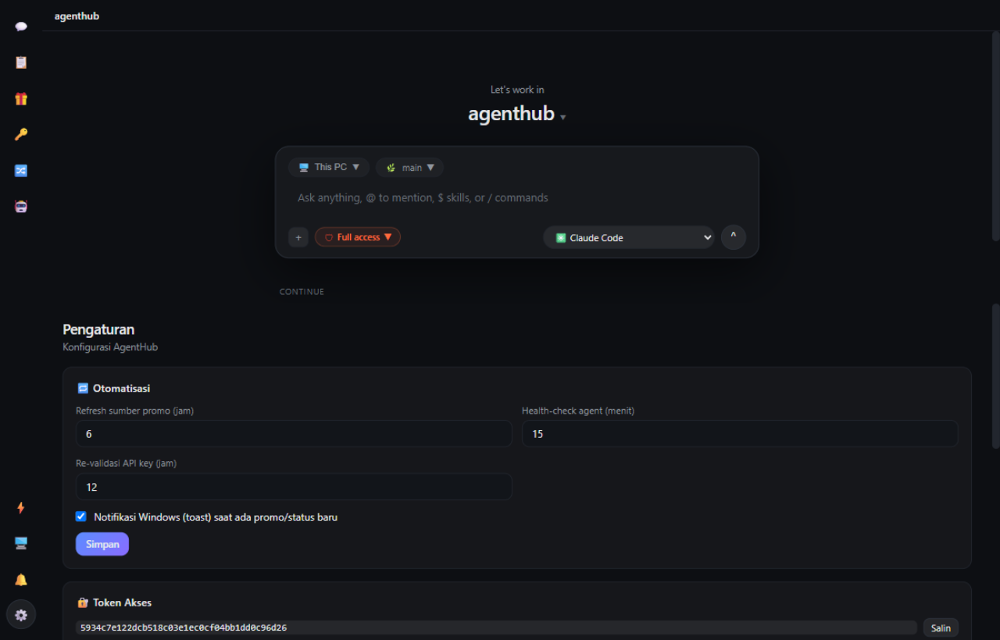
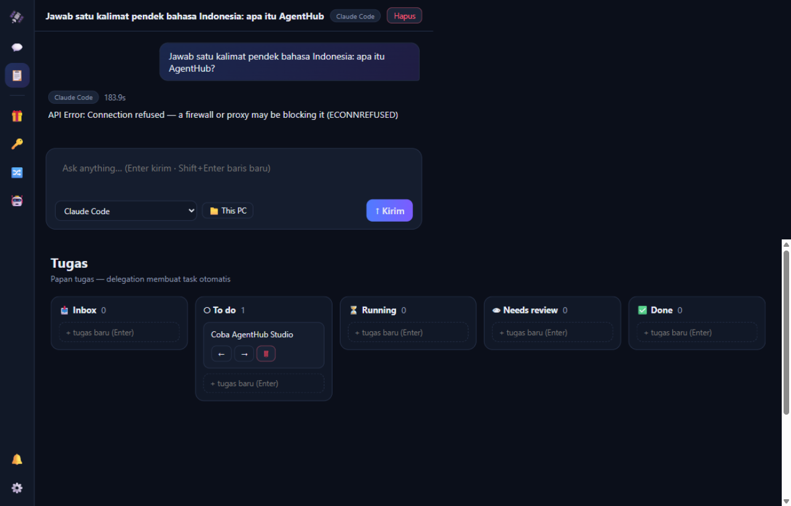
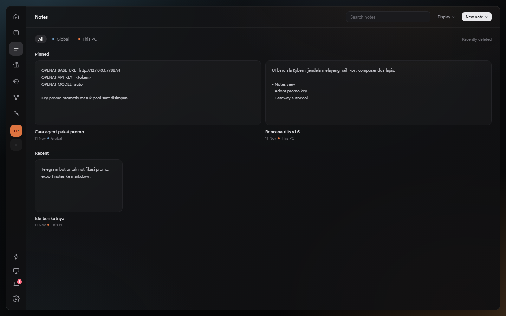
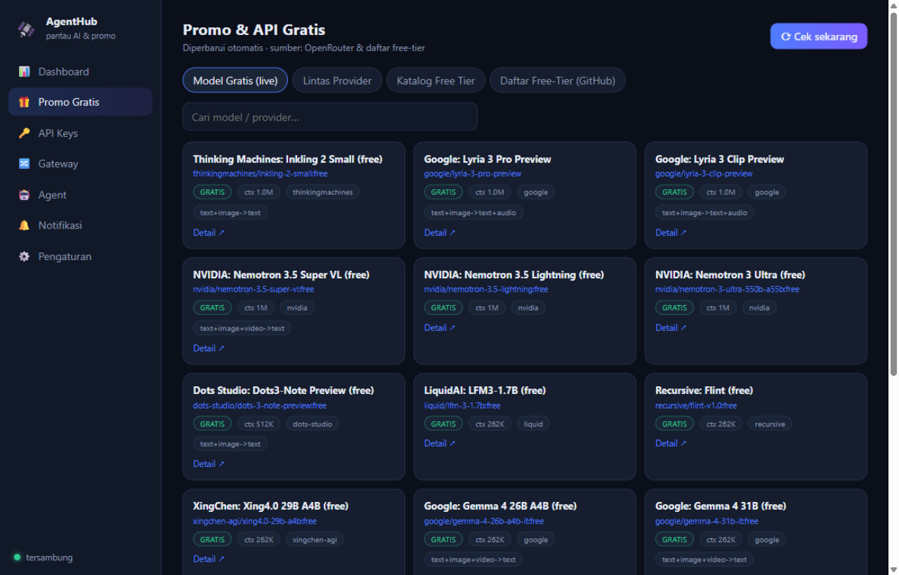

#  AgentHub

**The lightweight desktop control plane for free AI tokens.**

[](https://github.com/khadijahcollege-afk/AgentHub/releases/latest)
[](https://github.com/khadijahcollege-afk/AgentHub/actions/workflows/ci.yml)
[](LICENSE)


AgentHub watches **free AI model promos** from multiple internet sources, connects to your **agent apps**, and keeps them alive: when one free provider's quota runs out, traffic **fails over automatically** to the next one — all monitored from your phone.

> Dokumentasi berbahasa Indonesia: [README.id.md](README.id.md)

| Studio (chat) | Tasks board | Notes | Free promo tracking |
|---|---|---|---|
|  |  |  |  |

## Why AgentHub?

Free AI API tiers (Groq, Google AI Studio, Cerebras, OpenRouter `:free`, …) are great — until your agent hits the rate limit at the worst moment. AgentHub solves this with a **Gateway Pool**: your agents point at *one* endpoint, and AgentHub rotates through all your free keys.

-  **Studio** — chat directly with your agents in a native desktop app: pick an engine, type a prompt, watch it stream. Engines include the **free-token Gateway Pool** and installed **CLI harnesses** (Claude Code, Codex, OpenCode, Gemini CLI — auto-detected).
-  **Delegation** — send one prompt to several agents in parallel; results are collected into a single thread and a task appears on the board.
-  **Tasks board** — Inbox / To do / Running / Needs review / Done.
-  **Notes** — quick per-project notes with pinning, search, and a two-column pinned / recent board.
-  **Promo tracking** — live from [OpenRouter](https://openrouter.ai), [models.dev](https://models.dev) and the [free-llm-api-resources](https://github.com/raullenchai/free-llm-api-resources) list, plus a curated catalog with signup links. New free model detected → notification + Windows toast. Hit **Pakai di agent** on any free model, paste the promo key, and it joins the gateway pool immediately — ready for `OPENAI_BASE_URL` agents.
-  **Promo Pass / Start Plan** — claim the AgentHub Global Build ticket (300M tokens, GLM-5.3 + GLM-5.3-Flash with Vision) from the sidebar card or Promo view. The ticket shows its drop time and validity, Start Plan shows real per-model daily balances (reset 22:59), model toggles, display renaming, extra models, and +50% quota upgrades. Quota is consumed from the gateway's real `usage.total_tokens` whenever the upstream model matches the pass.
-  **Attachments** — drop, paste, or pick files and images in the composer (8 MB each, 5 per message). CLI engines receive real absolute paths; the gateway receives inlined text so a model without disk access can still read the file. Images render as thumbnails in the composer and transcript.
-  **Gateway Pool** — one OpenAI-compatible endpoint (`/v1/chat/completions`, `/v1/models`). `429` → 5-minute cooldown → traffic shifts to the next provider. Rejected keys (401) get disabled automatically. Supports streaming (`stream: true`).
-  **API key vault** — store keys for 11+ OpenAI-compatible presets (Groq, OpenRouter, Cerebras, Gemini, GitHub Models, Mistral, Together, DeepSeek, xAI, GLM, Hugging Face, custom). Periodic re-validation, keys masked in the UI.
-  **Agent connectors** — n8n/Make/custom webhooks and LLM endpoints; scheduled health checks with latency history.
-  **Phone access** — scan a QR, open the same dashboard over Wi-Fi. Realtime via SSE, protected by an access token.
-  **Internet access (optional tunnel)** — one toggle starts a Cloudflare quick tunnel, so your phone reaches AgentHub over **mobile data**, not just the same Wi-Fi. Honest status display (stopped/starting/online/error), off by default, one click to stop.
-  **Installable app (PWA)** — on Android Chrome, tap **Install** (Settings → Phone, or the browser's install prompt): AgentHub gets its own home-screen icon, launches full-screen without browser chrome, and the shell reopens instantly from the service-worker cache. API responses are never cached.
- **⌘ Composer power-ups** — `Ctrl+K` command palette, `@` file autocomplete from the working folder, real slash commands (`/new`, `/export`, `/engine`, `/model`, `/prompt`, `/save`, `/tasks`, …), a **prompt library** (save & reuse prompts, pin favorites), and **voice dictation** (Web Speech API, id-ID) when the browser supports it.
-  **One-tap model adoption** — the model catalog lists pool members plus cached free models; if a provider key is already saved, **Pakai langsung** activates the model and switches the engine to the Gateway in one tap — no key hunting.
-  **Usage & change review** — per-message token counts, an aggregate usage popover, and a *Perubahan* drawer that shows the git status/diff a run actually produced (with per-file restore).
-  **Local-first** — everything runs on your machine. No cloud, no telemetry. API keys stay on disk.
-  **Featherweight server** — pure Node.js, **zero npm dependencies** for the server itself; the desktop shell is a thin Electron wrapper (native window + tray, no browser).

## Install

AgentHub runs everywhere you do — one local server, five ways to install:

| Platform | Installer | How |
|---|---|---|
| **Windows 10/11** | `AgentHub-Setup.exe` (~82 MB) | [Releases](https://github.com/khadijahcollege-afk/AgentHub/releases/latest) — native window + tray, autostart. Recommended. |
| **Windows portable** | `AgentHub-Portable.zip` | Extract → `Start AgentHub.bat` (browser window, no desktop shell) |
| **macOS** | `AgentHub-macOS.dmg` | [Releases](https://github.com/khadijahcollege-afk/AgentHub/releases/latest) — built by CI. Unsigned: right-click → **Open** on first launch |
| **Linux** | `AgentHub-linux.AppImage` / `.deb` | [Releases](https://github.com/khadijahcollege-afk/AgentHub/releases/latest) — built by CI. `chmod +x` the AppImage |
| **Android** | PWA (installable web app) | Open the dashboard in Chrome → **Install** — home-screen icon, full-screen, offline shell |
| **iOS / iPhone** | PWA | Open the dashboard in Safari → **Share** → **Add to Home Screen** |
| **Any OS (web)** | none | `node server.js` (Node 18+) — works in any browser, UI fully responsive |

macOS/Linux installers are built automatically by [.github/workflows/release.yml](.github/workflows/release.yml) when a `v*` tag is pushed — three runners build their native targets and one job publishes them all to the same GitHub Release. The macOS build is unsigned (no Apple certificate); the app itself is identical everywhere because the server and UI are the same on every platform. To reach AgentHub over mobile data, start the optional tunnel in Settings → *Phone*.

On the first Windows launch the firewall may ask permission for Node.js — allow it so phones on the same Wi-Fi can connect.

**From source** (any OS with Node.js 18+):

```bash
git clone https://github.com/khadijahcollege-afk/AgentHub.git
cd AgentHub
node server.js
```

## Quick start

1. **Add free keys** — API Keys tab → pick a preset → paste key (grab free ones from the catalog: Groq, OpenRouter, Cerebras, …).
2. **Join the pool** — press **"+ Pool"** on each valid key.
3. **Point your agents at the gateway:**

```
Base URL : http://<your-pc-ip>:7788/v1
API Key  : <AgentHub access token — shown in the Gateway tab>
Model    : auto   |   groq/llama-3.3-70b-versatile   |   <model name>
```

Quota hit → AgentHub cools that provider down for 5 minutes and your request is served by the next one. Your agent never knows the difference.

4. **Scan the QR** from your phone (same Wi-Fi) to monitor everything remotely.

## Building from source

The installer is built with [NSIS](https://nsis.sourceforge.io):

```bash
# stage the app + a node.exe copy, then:
makensis /DXVER=1.2.3 /DSTAGE="<stage-dir>" packaging/agenthub.nsis
```

CI does this for you: pushing a tag `v*` runs [.github/workflows/release.yml](.github/workflows/release.yml), builds the installer & portable ZIP on a Windows runner, and publishes them to GitHub Releases.

## State machines & agent API

Every status in AgentHub (task, run, delegation step, connection, key/agent probe,
promo refresh, promo pass, overlay, view, note editor) is declared once in
[`lib/machines.js`](lib/machines.js). `public/machines.js` is generated from it, so
the server that enforces transitions and the UI that draws buttons can never
disagree. The full inventory — owner, persistence, enforcement point, and the
states left local on purpose — is in [`STATE-MACHINES.md`](STATE-MACHINES.md).

```bash
npm run machines   # regenerate public/machines.js
npm run check      # fail if the generated file drifted, then run the tests
npm test           # 114 tests: machines, HTTP contract, run + stop, recovery, workspace, search, history, promo pass, uploads, prompts, schedules, backup, PWA assets
```

Agents driving the app do not have to guess. The contract is served over HTTP:

| Endpoint | What it gives you |
| --- | --- |
| `GET /api/machines` | every state, transition, label, key-pool rule, and SSE scope |
| `GET /api/status` | what is running right now, recovered runs, task counts per column |
| `GET /api/version` | machine contract version + task statuses |
| `GET /api/events?format=json` | the SSE stream as newline-delimited JSON |
| `GET/POST /api/notes` | read and create project notes |
| `POST/DELETE /api/notes/:id` | patch or delete a note |
| `POST /api/keys` | add a key; with `autoPool` on it joins the gateway pool in one call |
| `GET /api/search?q=` | one query across threads, tasks, notes, and projects |
| `GET /api/promo/pass` | current promo pass, campaign window, quotas, and model usage |
| `POST /api/promo/pass/:action` | `claim`, `dismiss`, `toggle`, `add-model`, `rename`, `upgrade`, `share` |
| `POST /api/uploads` | store an attachment (JSON base64, 8 MB, returns `id`/`name`/`type`/`bytes`) |
| `GET/DELETE /api/uploads/:id` | stream or remove an attachment |
| `GET/POST /api/prompts`, `POST/DELETE /api/prompts/:id` | prompt library: save, pin, patch, and reuse composer prompts |
| `GET /api/models` · `POST /api/models/activate` | model catalog and one-tap activation reusing a saved provider key |
| `GET /api/usage` | aggregate token usage per engine |
| `GET/POST /api/tunnel` | optional cloudflared quick-tunnel: status, start, stop |
| `GET /api/files?cwd=&q=` | read-only folder listing that powers `@` autocomplete |
| `POST /api/threads/:id/stop` | stop the active run; always `200`, idempotent |
| `GET/POST /api/schedules`, `POST/DELETE /api/schedules/:id(/run)` | jadwal prompt berulang: buat, aktifkan, jalankan sekarang, hapus |
| `GET /api/backup` · `POST /api/restore` | ekspor semua data ke satu JSON | `GET /api/threads/:id/stats`  pulihkan (config/token tidak ikut) |
| `GET /api/threads/:id/stats` | statistik sesi: pesan, token per jenis, blok konteks (batas model dari katalog, %, cache hit rate) |
| `GET /api/threads/:id/workspace` | workspace repo, branch, changed files, rule files |
| `GET /api/threads/:id/diff` | changed files with `+/-` and a bounded patch |
| `POST /api/threads/:id/revert` | restore tracked files; untracked only with an explicit flag |
| `POST /api/threads/:id/rules` | write one allow-listed rule file (`AGENTS.md`, `CLAUDE.md`, …) |

Task movement is strictly linear: `inbox → todo → running → review → done`. A skip is
rejected with `409` and a body containing `allowed`, so a client can correct itself
instead of silently diverging.

One run per thread: a second `POST /api/threads/:id/send` while a run is active is
rejected with `409 RUN_IN_PROGRESS` before anything is written, and a thread left
"running" by a crash is recovered as `error` on startup (counted in
`recoveredRuns`), so the UI never shows phantom work with a locked send button.
Conversations keep context: the pool engine receives the thread's prior
user/assistant turns (last 12 messages, 12k characters max) so a follow-up refers
to the same work. CLI engines are invoked per message and keep their own session
model.
In the page, `window.__ahState()` returns the live state and `window.__ahMachines`
the rules — both for the same contract the server enforces.

Each thread owns a workspace. The workspace picker can point **This PC** at any
absolute folder — the server validates it through `GET /api/workspace/check`
before the path is stored, so a typo cannot become a thread with a phantom
workspace. The studio keeps a **Perubahan** drawer that shows
what a run actually changed (git status, `+/-`, patch) and can restore a file to
HEAD — tracked files only by default, new files only when you confirm deletion.
The same drawer edits the project's rule files (`AGENTS.md`, `CLAUDE.md`,
`.cursorrules`, Copilot instructions), so the memory the next agent reads is one
click away instead of buried in the repo.

Search is global: the sidebar box (and the **Cari semua…** command) queries
thread titles and message bodies, task titles, note titles/bodies, and project
names/folders in one request. Results keep their group and a snippet around the
match, so you can jump straight to the conversation or note that decided
something — no separate index to rebuild.

Promo Pass is a small state machine of its own: `available → pending|active →
expired`, scheduled around a 22:00 drop, a 10-hour ticket, and a three-day plan
that ends at 22:59. The server owns the schedule, quota math, billing day, and
real gateway usage; the UI only draws the card, ticket, and Start Plan from
`GET /api/promo/pass`. Actions return the same public shape, so a client never
has to guess the next state.

Attachments are files, not a machine: the server enforces the limits (8 MB each,
5 per message, basename-only names, no path traversal) and stores metadata plus
the bytes in the data dir — never in the user's repo. `POST /send` validates every
attachment id before writing the user message, so an invalid id cannot leave a
half-saved turn. Pool runs get inlined text, CLI runs get absolute paths.

Confirmation is part of the app, not the browser: every destructive action and
text prompt uses one accessible overlay (`role="dialog"`, Esc/Enter, focus trap,
queued when two actions race). Native `confirm()`/`prompt()` are banned by a
static test because Electron and embedded webviews block them — and an agent
driving the UI through CDP could not answer them. The active dialog is visible in
`window.__ahState().dialog`, so automation can wait for it, fill it, and confirm.

## Privacy & security

- Runs on `0.0.0.0:7788` so phones can connect; every `/api/*` route requires an access token (shown in Settings, regenerable). The UI shell itself is public but contains no secrets — the gate appears before any data loads.
- API keys live in `data/keys.json` (source mode) or `%APPDATA%\AgentHub` (installed) — local only, never sent anywhere except the provider you chose. Keys are always masked in the UI and masked values are rejected on submit.
- The optional tunnel publishes your AgentHub to a public `trycloudflare.com` URL. The UI states it plainly: **anyone with the link + token can control your agents** — the tunnel is off by default and one click to stop.
- `data/` is git-ignored, so a `git push` can never leak your keys, tokens, or conversation history.

## Desktop shell notes

The Electron shell (`desktop/main.js`) starts the server as a child process, remembers a single instance, and keeps running minimized to the tray — closing the window does not stop monitoring. "Run at PC startup" can be toggled from the tray menu.

[Benchmark](docs/BENCHMARK.md) — angka terukur AgentHub (cold start, memori, throughput) + matriks fitur vs ChatGPT, Claude, OpenCode, Kybern, ZCode, Gemini.

## License

[MIT](LICENSE) — free to use, modify and ship.
