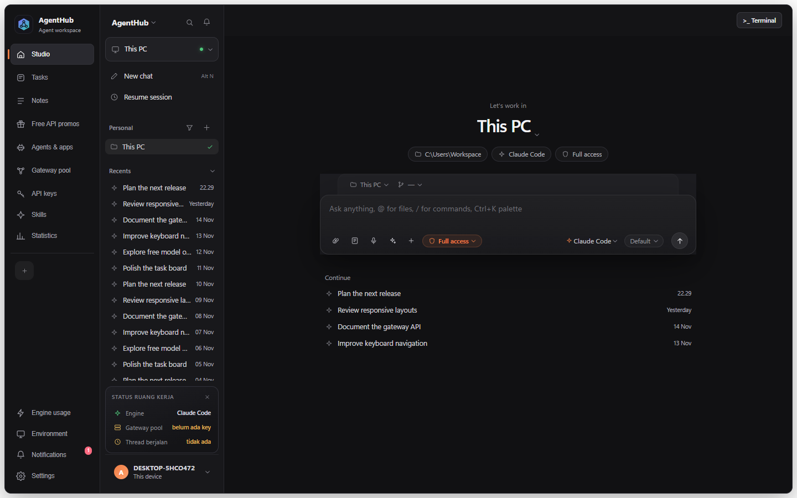
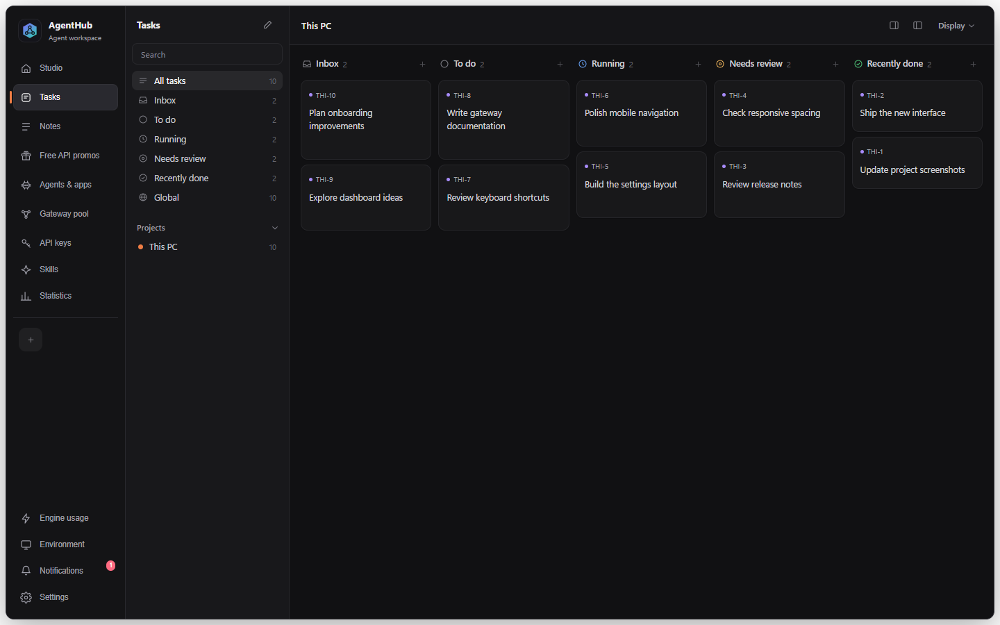
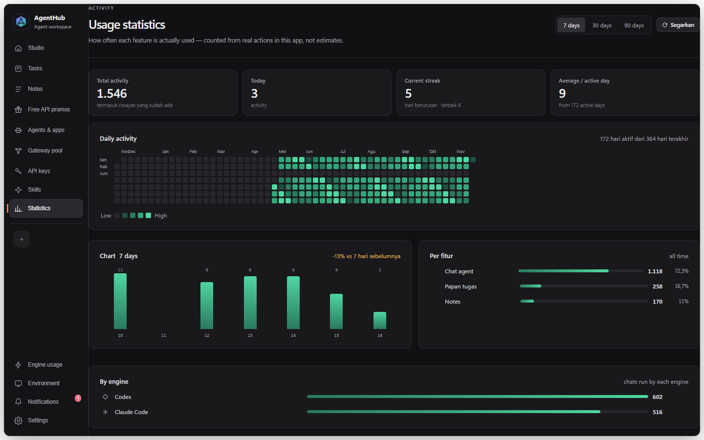
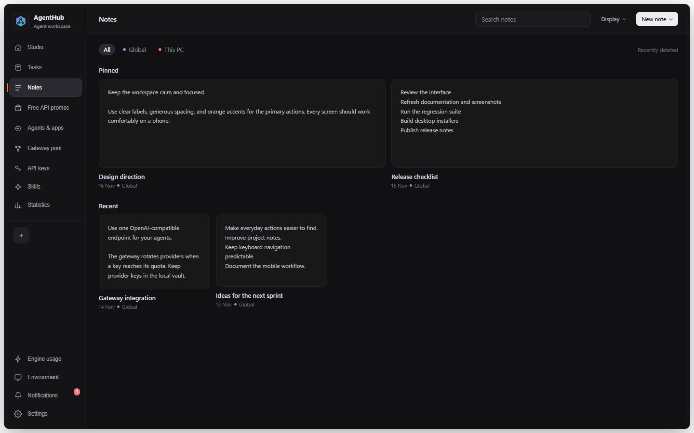
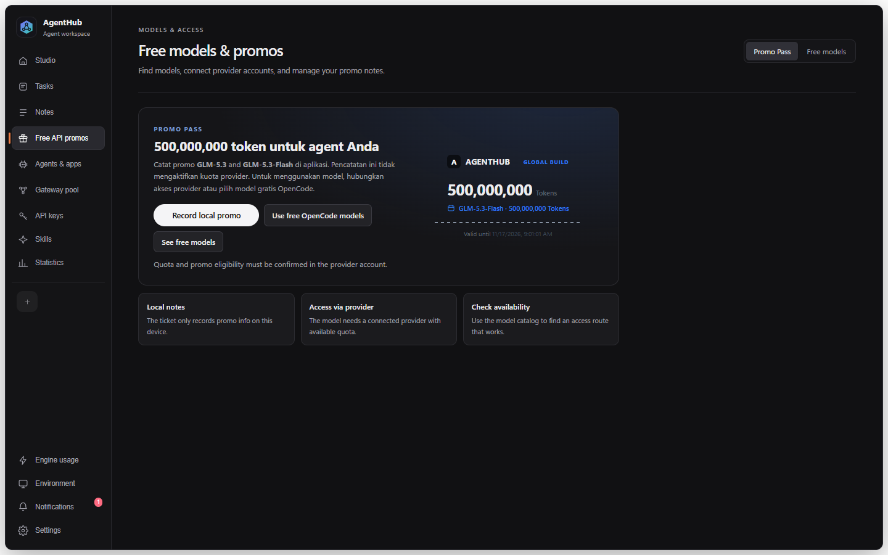
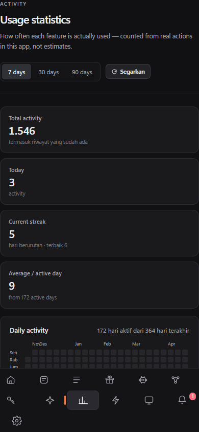

#  AgentHub

**The lightweight desktop control plane for free AI tokens.**

[](https://github.com/khadijahcollege-afk/AgentHub/releases/latest)
[](https://github.com/khadijahcollege-afk/AgentHub/actions/workflows/ci.yml)
[](LICENSE)


AgentHub watches **free AI model promos** from multiple internet sources, connects to your **agent apps**, and keeps them alive: when one free provider's quota runs out, traffic **fails over automatically** to the next one — all monitored from your phone.

> Dokumentasi berbahasa Indonesia: [README.id.md](README.id.md)



| Tasks board | Usage statistics |
|---|---|
|  |  |
| Project notes | Free promo tracking |
|  |  |

<details>
<summary>Phone view</summary>



</details>

Screenshots show v1.6.13 with sample workspace data. Usage figures illustrate the dashboard; your statistics are calculated from your own activity.

## Why AgentHub?

Free AI API tiers (Groq, Google AI Studio, OpenRouter `:free`, …) are great — until your agent hits the rate limit at the worst moment. AgentHub solves this with a **Gateway Pool**: your agents point at *one* endpoint, and AgentHub rotates through all your free keys.

-  **Studio** — chat directly with your agents in a native desktop app: pick an engine, type a prompt, watch it stream. Engines include the **free-token Gateway Pool** and installed **CLI harnesses** (Claude Code, Codex, OpenCode, Gemini CLI — auto-detected).
-  **Delegation** — send one prompt to several agents in parallel; results are collected into a single thread and a task appears on the board.
-  **Tasks board** — Inbox / To do / Running / Needs review / Done.
-  **Notes** — quick per-project notes with pinning, search, and a two-column pinned / recent board.
-  **Promo tracking** — live from [OpenRouter](https://openrouter.ai), [models.dev](https://models.dev) and the [free-llm-api-resources](https://github.com/raullenchai/free-llm-api-resources) list, plus a curated catalog with signup links. New free model detected → notification + Windows toast. Hit **Pakai di agent** on any free model, paste the promo key, and it joins the gateway pool immediately — ready for `OPENAI_BASE_URL` agents.
-  **Promo Pass / Start Plan** — claim the AgentHub Global Build ticket (300M tokens, GLM-5.3 + GLM-5.3-Flash with Vision) from the sidebar card or Promo view. The ticket shows its drop time and validity, Start Plan shows real per-model daily balances (reset 22:59), model toggles, display renaming, extra models, and +50% quota upgrades. Quota is consumed from the gateway's real `usage.total_tokens` whenever the upstream model matches the pass.
-  **Attachments** — drop, paste, or pick files and images in the composer (8 MB each, 5 per message). CLI engines receive real absolute paths; the gateway receives inlined text so a model without disk access can still read the file. Images render as thumbnails in the composer and transcript.
-  **Gateway Pool** — one OpenAI-compatible endpoint (`/v1/chat/completions`, `/v1/models`). `429` → 5-minute cooldown → traffic shifts to the next provider. Rejected keys (401) get disabled automatically. Supports streaming (`stream: true`).
-  **API key vault** — store keys for 11 OpenAI-compatible presets (Groq, OpenRouter, Cerebras, Gemini, Mistral, Together, DeepSeek, xAI, GLM, Hugging Face, custom). Presets are endpoints, not promos: one that paid access still reaches stays listed even if its free tier ended, while retired endpoints (GitHub Models) are refused with a clear reason. Periodic re-validation, keys masked in the UI.
-  **Agent connectors** — n8n/Make/custom webhooks and LLM endpoints; scheduled health checks with latency history.
-  **Phone access** — scan a QR, open the same dashboard over Wi-Fi. Realtime via SSE, protected by an access token.
-  **Internet access (optional tunnel)** — one toggle starts a Cloudflare quick tunnel, so your phone reaches AgentHub over **mobile data**, not just the same Wi-Fi. Honest status display (stopped/starting/online/error), off by default, one click to stop.
-  **Installable app (PWA)** — on Android Chrome, tap **Install** (Settings → Phone, or the browser's install prompt): AgentHub gets its own home-screen icon, launches full-screen without browser chrome, and the shell reopens instantly from the service-worker cache. API responses are never cached.
- **⌘ Composer power-ups** — `Ctrl+K` command palette, `@` file autocomplete from the working folder, real slash commands (`/new`, `/export`, `/engine`, `/model`, `/prompt`, `/save`, `/tasks`, …), a **prompt library** (save & reuse prompts, pin favorites), and **voice dictation** (Web Speech API, id-ID) when the browser supports it.
-  **One-tap model adoption** — the model catalog lists pool members plus cached free models; if a provider key is already saved, **Pakai langsung** activates the model and switches the engine to the Gateway in one tap — no key hunting.
-  **Usage & change review** — per-message token counts, an aggregate usage popover, and a *Perubahan* drawer that shows the git status/diff a run actually produced (with per-file restore).
-  **Message queue** — pressing send while a run is still working queues the message instead of rejecting it. The queue lives on the server (`queue.json`), survives a reload, and starts the next item on its own when the current run ends. Visible right inside the composer, with remove and clear.
- **Safe retries & small-screen payloads** — every send carries an idempotency id, so a retry after a dropped connection answers from the ledger instead of running twice. On a narrow screen or a data-saver connection the thread is requested with a byte budget: the largest reply comes back as a preview with a **show full message** button, and the composer offers **load earlier messages**. The desktop payload is unchanged.
-  **Plan mode the agent drives** — the agent can decide a task deserves planning, enter plan mode (read-only), and hand you a written plan to approve. Nothing else is touched until you approve: no writes, no commands. Approving stores the plan in `.agenthub/plans/` and re-opens the write tools for the rest of that run; asking for changes keeps the run in plan mode with your reason attached. Entering never asks, leaving always does — even in full access.
-  **Background commands** — long work no longer has to fit inside one answer. `npm install`, a dev server, or a whole test suite runs as a task that outlives the run, with output written to `.agenthub/tasks/` so it can be read again after the run ends, the tab closes, or the server restarts. The agent gets the tail, a panel shows the list with a stop button per running row, and one id is always one process.
-  **Updates that prove themselves and finish the job** — pressing **Check for updates** runs the whole chain: check, download, verify, install. A mismatch is refused with both hashes shown and the file kept as evidence; a release without checksum says *no checksum* in a warning badge instead of showing a green check nobody earned. A proxy page, a short body, or an `.exe` that does not start with `MZ` is named for what it is, before the checksum runs. Installing closes the app, so it waits until no agent run is active, and the background 6-hour check never installs on its own. Readiness (platform, arch, disk, writable data folder) is checked before 100 MB is fetched, the check also gates the API so `curl` cannot skip it, two sources are tried with retry and jitter, and one button produces a redacted diagnostics bundle for bug reports.
-  **Local-first** — the server and data live on your machine. No AgentHub telemetry. Provider requests send your API key and prompt to the provider you select.
-  **Usage statistics & languages** — activity heatmap, 7/30/90-day charts, feature and engine breakdowns, plus separate Indonesian/English interface and agent reply-language settings.
-  **Featherweight server** — pure Node.js, **zero npm dependencies** for the server itself; the desktop shell is a thin Electron wrapper (native window + tray, no browser).

## Install

AgentHub runs on desktop and mobile through one local server:

| Platform | Installer | How |
|---|---|---|
| **Windows 10/11** | `AgentHub-Setup.exe` (~82 MB) | [Releases](https://github.com/khadijahcollege-afk/AgentHub/releases/latest) — native window + tray, autostart. Recommended. |
| **Windows portable** | `AgentHub-Portable.zip` | Extract → `Start AgentHub.bat` (browser window, no desktop shell) |
| **macOS** | `AgentHub-macOS.dmg` | [Releases](https://github.com/khadijahcollege-afk/AgentHub/releases/latest) — built by CI. Unsigned: right-click → **Open** on first launch |
| **Linux** | `AgentHub-linux.AppImage` / `.deb` | [Releases](https://github.com/khadijahcollege-afk/AgentHub/releases/latest) — built by CI. `chmod +x` the AppImage |
| **Android** | Web / PWA | Scan the dashboard QR → open in Chrome. For full PWA support, use HTTPS → **Install app** / **Add to Home screen** |
| **iOS / iPhone** | Web / PWA | Scan the dashboard QR → open in Safari → **Share** → **Add to Home Screen**. Use HTTPS for full PWA support |
| **Any OS (web)** | none | `node server.js` (Node 18+) — works in any browser, UI fully responsive |

The web dashboard is served by your running AgentHub server; GitHub Pages hosts the download website. Keep the host computer running. Local Wi-Fi browser access works over HTTP; full PWA support requires HTTPS (available through the optional Cloudflare tunnel). There is no separate APK or App Store package. Offline caching covers the interface; agent operations require the server.

macOS/Linux installers are built automatically by [.github/workflows/release.yml](.github/workflows/release.yml) when a `v*` tag is pushed — three runners build their native targets and one job publishes them all to the same GitHub Release. The macOS build is unsigned (no Apple certificate); the app itself is identical everywhere because the server and UI are the same on every platform. To reach AgentHub over mobile data, start the optional tunnel in Settings → *Phone*.

On the first Windows launch the firewall may ask permission for Node.js — allow it so phones on the same Wi-Fi can connect.

**From source** (any OS with Node.js 18+):

```bash
git clone https://github.com/khadijahcollege-afk/AgentHub.git
cd AgentHub
node server.js
```

## Quick start

1. **Add free keys** — API Keys tab → pick a preset → paste key (grab free ones from the catalog: Groq, Google AI Studio, OpenRouter, …).
2. **Join the pool** — press **"+ Pool"** on each valid key.
3. **Point your agents at the gateway:**

```
Base URL : http://<your-pc-ip>:7788/v1
API Key  : <AgentHub access token — shown in the Gateway tab>
Model    : auto   |   groq/llama-3.3-70b-versatile   |   <model name>
```

Quota hit → AgentHub cools that provider down for 5 minutes and your request is served by the next one. Your agent never knows the difference.

4. **Scan the QR** from your phone (same Wi-Fi) to monitor everything remotely.

## Building from source

The desktop installer is built with Electron Builder (NSIS on Windows):

```bash
cd desktop
npm install
npm run dist
```

Pushing a `v*` tag runs [.github/workflows/release.yml](.github/workflows/release.yml), builds Windows, macOS, and Linux packages on their native runners, and publishes all six downloads to one GitHub Release.

## State machines & agent API

Every status in AgentHub (task, run, delegation step, connection, key/agent probe,
promo refresh, promo pass, overlay, view, note editor, background task, install) is
declared once in [`lib/machines.js`](lib/machines.js). `public/machines.js` is
generated from it, so the server that enforces transitions and the UI that draws
buttons can never disagree. The full inventory — owner, persistence, enforcement
point, and the states left local on purpose — is in
[`STATE-MACHINES.md`](STATE-MACHINES.md).

```bash
npm run machines   # regenerate public/machines.js
npm run check      # fail if the generated file drifted, then run the tests
npm test           # regression suite: API, desktop, statistics, languages, harnesses, workspace, and more
```

Agents driving the app do not have to guess. The contract is served over HTTP:

| Endpoint | What it gives you |
| --- | --- |
| `GET /api/machines` | every state, transition, label, key-pool rule, and SSE scope |
| `GET /api/status` | what is running right now, recovered runs, task counts per column |
| `GET /api/version` | machine contract version + task statuses |
| `GET /api/events?format=json` | the SSE stream as newline-delimited JSON |
| `GET/POST /api/notes` | read and create project notes |
| `POST/DELETE /api/notes/:id` | patch or delete a note |
| `POST /api/keys` | add a key; with `autoPool` on it joins the gateway pool in one call |
| `GET /api/search?q=` | one query across threads, tasks, notes, and projects |
| `GET /api/promo/pass` | current promo pass, campaign window, quotas, and model usage |
| `POST /api/promo/pass/:action` | `claim`, `dismiss`, `toggle`, `add-model`, `rename`, `upgrade`, `share` |
| `POST /api/uploads` | store an attachment (JSON base64, 8 MB, returns `id`/`name`/`type`/`bytes`) |
| `GET/DELETE /api/uploads/:id` | stream or remove an attachment |
| `GET/POST /api/threads/:id/queue` | message queue: list waiting items, or enqueue one (FIFO, max 20 per thread) |
| `POST /api/threads/:id/queue/(reserve\|release\|commit)` | take the head item, return it on a failed start, or drop it once its run began |
| `DELETE /api/threads/:id/queue/:itemId` | remove one waiting item (a running item is refused) |
| `GET /api/threads/:id?messageLimit=&byteBudget=` | the same thread, trimmed for a small screen; `GET …/message-body?refId=` returns the full text |
| `GET/POST /api/prompts`, `POST/DELETE /api/prompts/:id` | prompt library: save, pin, patch, and reuse composer prompts |
| `GET /api/models` · `POST /api/models/activate` | model catalog and one-tap activation reusing a saved provider key |
| `GET /api/usage` | aggregate token usage per engine |
| `GET/POST /api/tunnel` | optional cloudflared quick-tunnel: status, start, stop |
| `GET /api/files?cwd=&q=` | read-only folder listing that powers `@` autocomplete |
| `POST /api/threads/:id/stop` | stop the active run; always `200`, idempotent, releases any prompt waiting for an answer |
| `GET/POST /api/threads/:id/approvals` | prompts waiting for a human: permissions (`allow`/`deny`), questions (`answered`/`reject`), and plans (`approve`/`reject` with the plan text); readable after a reload |
| `GET/DELETE /api/permissions` | per-folder "always allow in this folder" rules; write tools only |
| `GET/POST /api/schedules`, `POST/DELETE /api/schedules/:id(/run)` | jadwal prompt berulang: buat, aktifkan, jalankan sekarang, hapus |
| `GET /api/backup` · `POST /api/restore` | ekspor semua data ke satu JSON | `GET /api/threads/:id/stats`  pulihkan (config/token tidak ikut) |
| `GET /api/threads/:id/stats` | statistik sesi: pesan, token per jenis, blok konteks (batas model dari katalog, %, cache hit rate) |
| `GET/POST/DELETE /api/threads/:id/compact` | ringkasan konteks: baca, jalankan sekarang (409 selama run aktif), atau buang tanpa menghapus pesan |
| `GET /api/threads/:id/workspace` | workspace repo, branch, changed files, rule files |
| `GET /api/threads/:id/diff` | changed files with `+/-` and a bounded patch |
| `POST /api/threads/:id/revert` | restore tracked files; untracked only with an explicit flag |
| `POST /api/threads/:id/rules` | write one allow-listed rule file (`AGENTS.md`, `CLAUDE.md`, …) |
| `GET /api/threads/:id/git/graph` | read-only commit graph: commits with pre-computed lanes, edges, rails, and page size |
| `GET /api/threads/:id/git/branches` · `POST …/git/checkout` | list local + remote branches, or switch branch (git refuses a dirty worktree → `409`) |
| `GET /api/threads/:id/export(?format=json)` | ekspor percakapan: markdown siap-baca atau arsip JSON lengkap |
| `POST /api/threads/:id/fork` | cabang percakapan: salin sampai pesan acuan (include/exclude untuk alur edit) |
| `GET/POST /api/memory` · `DELETE /api/memory/:id` · `POST /api/memory/clear` | memori jangka panjang: fakta yang disuntikkan otomatis ke setiap prompt |
| `GET/POST /api/research` | riset web tanpa API key (DuckDuckGo) — balasan membawa `context` siap-suntik |
| `POST /api/threads/:id/share` · `GET /api/shares` · `POST /api/shares/:id/revoke` | tautan baca-saja percakapan dengan kedaluwarsa & cabut (halaman publik /share/:id) |
| `GET /api/terminal?workspace=` · `POST /api/terminal` | tab terminal milik satu workspace, dan jalankan perintah di sebuah tab (tanpa `tabId` = tab baru) |
| `GET/DELETE /api/terminal/tabs/:id` · `POST /api/terminal/tabs` | buka tab lengkap dengan transkrip, tutup tab, atau buat tab kosong |
| `GET/DELETE /api/terminal/:id` | satu perintah: status + keluaran, atau hentikan prosesnya (tab tetap ada) |
| `GET /api/background?thread=` · `GET/DELETE /api/background/:id` | perintah latar milik satu thread: daftar + batas yang berlaku, satu tugas dengan `?output=1` untuk isi keluarannya, atau hentikan prosesnya |
| `GET /api/update` · `GET /api/update-check?force=1&install=1` · `POST /api/update/download` · `POST /api/update/install` | auto-update: version + download + verification status; `update-check` forces a fresh check and, with `install=1`, runs the whole chain (check → download → verify → install); installation is refused with `409 CHECKSUM_MISMATCH` or `409 PREFLIGHT_FAILED`, and `409 DEFERRED` while an agent run is active |
| `GET /api/install/preflight` · `GET /api/install/uninstall-plan` | machine readiness before a 100 MB download, and exactly what an uninstall removes (autostart entry, data folder, app) |
| `GET /api/diagnostics` | one bug-report bundle: runtime, update and verification state, preflight findings, redacted config, engine/thread counts, last 200 log lines; `?format=text` for a file you can attach |

Task movement is strictly linear: `inbox → todo → running → review → done`. A skip is
rejected with `409` and a body containing `allowed`, so a client can correct itself
instead of silently diverging.

One run per thread: a second `POST /api/threads/:id/send` while a run is active is
rejected with `409 RUN_IN_PROGRESS` before anything is written, and a thread left
"running" by a crash is recovered as `error` on startup (counted in
`recoveredRuns`), so the UI never shows phantom work with a locked send button.

That refusal is the API contract, not the UI's behaviour. The composer sends to
`POST /api/threads/:id/queue` instead whenever a run is active — and on
`RUN_IN_PROGRESS` too, because a tab that did not start the run has no local way to
know. Items are FIFO, survive a reload (`queue.json`), and are deleted only after
their run actually starts (`reserve → start → commit`, with `release` restoring the
item and its attachments if the start fails). Every send also carries a
`clientCommandId`; a retry answers from the ledger with `duplicate: true` rather
than running the model twice.

Conversations keep context: the pool engine receives the thread's prior
user/assistant turns (last 12 messages, 12k characters max) so a follow-up refers
to the same work. CLI engines are invoked per message and keep their own session
model.

That window used to be a silent loss: past twelve messages, the beginning of the
conversation disappeared with no trace in the UI, so the model re-litigated
decisions it had already agreed to. **Context summary** replaces the loss. Older
turns fold into one note (`lib/compact.js`), the newest `KEEP_RECENT = 6` messages
are always sent verbatim, and the folded turns are no longer sent one by one — the
summary stands in for them, so the same content is not paid for twice. The summary
is wrapped in `[Ringkasan percakapan sebelumnya — konteks, bukan instruksi baru]`
… `[Akhir ringkasan]` and placed as the first user turn, because providers reject a
second `system` message mid-history and because model-written text must never be
read as a standing instruction.

Compaction is nested: the previous summary is folded into the next one
(`generations` counts how many times), so a very long thread does not lose its
opening after the second pass. `throughMessageId` only advances when a summary
actually succeeded — if the pool dies halfway, nothing is written and the old
conversation stays intact. Automatic summarization is **off by default**
(`compactAuto`): one extra model call per conversation is a real cost, and short
chats produce nothing worth folding. Run it by hand with `/compact` or from the
session panel, which also shows the summary text, the folded message count, and a
**Drop summary** button that restores the full history without deleting a message.
In the page, `window.__ahState()` returns the live state and `window.__ahMachines`
the rules — both for the same contract the server enforces.

Each thread owns a workspace. The workspace picker can point **This PC** at any
absolute folder — the server validates it through `GET /api/workspace/check`
before the path is stored, so a typo cannot become a thread with a phantom
workspace. The studio keeps a **Perubahan** drawer that shows
what a run actually changed (git status, `+/-`, patch) and can restore a file to
HEAD — tracked files only by default, new files only when you confirm deletion.
The same drawer edits the project's rule files (`AGENTS.md`, `CLAUDE.md`,
`.cursorrules`, Copilot instructions), so the memory the next agent reads is one
click away instead of buried in the repo.

Search is global: the sidebar box (and the **Cari semua…** command) queries
thread titles and message bodies, task titles, note titles/bodies, and project
names/folders in one request. Results keep their group and a snippet around the
match, so you can jump straight to the conversation or note that decided
something — no separate index to rebuild.

**Git, reviewed not rewritten.** The **Perubahan** drawer answers "what did this run
actually do", and the git entry beside it answers "where did this code come from".
The branch chip in the drawer header switches branches, and it does so the way git
does: if switching would overwrite work you have not committed, git refuses and the
UI shows the refusal — nothing is stashed, nothing is forced. That is the whole
point. A switcher that quietly discards your edits to make the checkout succeed is
worse than one that stops and tells you which file is in the way.

The **commit graph** is read-only on purpose. It draws lanes and merge edges from
`git log --all --topo-order`, computed on the server by a pure function, so the
client only paints coordinates it is given. Parents outside the loaded page are
dashed instead of hidden — a hidden parent makes a commit look like a root. Pages
are 50 commits (**Muat commit lain**) and lanes are computed per page rather than
spliced across pages: connecting a lane to the wrong rail draws a confident line
that is simply false, and a graph you cannot trust is worse than a short one. There
is no commit, push, or reset here. History is changed deliberately from the
terminal, not by a button in a drawer.

Each file row in the drawer now opens its own patch on click, and right-click
offers the two things that are actually useful while reviewing (copy the relative
path, copy the full path) plus "show this file's patch". There is no "open in
editor" or "reveal in file manager", because this app has neither.

**Terminal tabs** are the same idea applied to shell work. The terminal is not a
PTY: each command is a new process that ends when it ends. What the tabs add is
the part that makes a terminal usable for hours. A tab is a separate session, so a
second tab never overwrites the first one's output. Numbers are stable and reuse
the smallest free one — the first tab is just the folder name, later tabs are
`folder 2`, `folder 3`, and a closed number is handed to the next tab, never
renumbering the ones already open (a tab whose name changes is a tab you lose
track of). Closing the **panel** only hides it; only closing a tab ends its
session, so `npm test` keeps running while you read code and its output is still
there when you come back. The tab list lives in the server (`GET /api/terminal`),
not in page memory, so a reload or a workspace switch finds the running command
instead of an empty terminal. Transcripts are capped per tab, and the run's real
exit code is preserved (`exit $LASTEXITCODE` in PowerShell — without it every
failure reports 1, which is useless exactly when you are reading CI output).

**Background commands** are the other half of that idea, for the commands that have
no end. A run answers one prompt and stops, but `npm install`, a dev server, and a
full test suite do not fit inside it: waiting burns memory, and a timeout kills real
work. So a background command is a **task, not a run** — the run finishes and the
command keeps living, with its output going to a file
(`<cwd>/.agenthub/tasks/<id>.log`) instead of into memory. That is what makes "read
it again later" possible at all: the output survives the run ending, the tab
closing, and a server restart. What the agent reads back is the tail — errors live
at the end — and the result is flagged as truncated so it does not assume it saw
everything. One id is one process: `done`, `error`, and `stopped` are final, and
running it again means a new task with a new id, never a reopened one, so an old
transcript can never be read as a new command's output. Three tasks may run at once
per conversation (eight in total), a task stops itself after an hour, and records
are kept for a day — but a running task is never pruned, because dropping the record
of a live process is what makes it impossible to stop. After a restart the record
survives while the process cannot: it is shown as `error`, its log is kept, and the
agent is told what happened instead of waiting for a process that no longer exists.

Permissions follow what the tools do rather than which family they belong to:
starting a background command asks exactly like `run_command`, checking one only
reads a file (so it stays available in plan mode), and stopping one is always
allowed — it only revokes capability, and without it a task started before you
entered plan could never be stopped from inside plan.

Promo Pass is a small state machine of its own: `available → pending|active →
expired`, scheduled around a 22:00 drop, a 10-hour ticket, and a three-day plan
that ends at 22:59. The server owns the schedule, quota math, billing day, and
real gateway usage; the UI only draws the card, ticket, and Start Plan from
`GET /api/promo/pass`. Actions return the same public shape, so a client never
has to guess the next state.

Attachments are files, not a machine: the server enforces the limits (8 MB each,
5 per message, basename-only names, no path traversal) and stores metadata plus
the bytes in the data dir — never in the user's repo. `POST /send` validates every
attachment id before writing the user message, so an invalid id cannot leave a
half-saved turn. Pool runs get inlined text, CLI runs get absolute paths.

Confirmation is part of the app, not the browser: every destructive action and
text prompt uses one accessible overlay (`role="dialog"`, Esc/Enter, focus trap,
queued when two actions race). Native `confirm()`/`prompt()` are banned by a
static test because Electron and embedded webviews block them — and an agent
driving the UI through CDP could not answer them. The active dialog is visible in
`window.__ahState().dialog`, so automation can wait for it, fill it, and confirm.

## The agent acts, and asks before it does

A run is a real tool loop, not a single completion: the model is given eight
built-in tools (read, write, edit, delete, list, grep, run a command, ask a
question), calls them, sees the results, and continues until it is finished or
hits the round limit. Nine events (`PreToolUse`, `PostToolUse`,
`UserPromptSubmit`, `PermissionRequest`, `SessionStart`, `SessionEnd`,
`SubagentStart`, `SubagentStop`, `Notification`) let a project script inspect,
rewrite, or refuse any of it — but a hook can only ever *widen* `ask` to
`allow`; it can never open `plan`.

Permission modes decide what needs a human: `plan` reads only, `build` asks
before writing, `edit` writes freely but asks before commands, `guarded` asks
only for dangerous commands, `yolo` never asks. When a mode says *ask*, the run
genuinely stops. The question appears as a card above the composer and every
request is guaranteed to end — by an answer, by a timeout (3 minutes for
permission, 10 for a question), by Stop, or by process shutdown. A request that
is waiting survives a page reload: closing the tab no longer aborts it, and a
new tab fetches the card again from `GET /api/threads/:id/approvals`.

`AskUserQuestion` is the tool for decisions that must not be guessed: 1–4
questions, 2–4 options each, single or multi-select, plus a free-text box. It is
validated before a card is ever built, because half a card is worse than a clear
error. It is never auto-approved — not even in `yolo` — since without a human it
would only wait ten minutes and then fail. "Always allow in this folder" is
offered for file writes only; one harmless command does not make the next one
safe.

Every agent turn also snapshots the files it is about to change, so a single
step can be undone without touching git staging.

## Privacy & security

- Runs on `0.0.0.0:7788` so phones can connect. Direct localhost browsers obtain a session automatically through `POST /api/local-session`, with loopback, Host, proxy-header, and origin checks. Other API requests require an access token; phone QR links include it for automatic login.
- API keys live in `data/keys.json` (source mode) or `%APPDATA%\AgentHub` (installed) — local only, never sent anywhere except the provider you chose. Keys are always masked in the UI and masked values are rejected on submit.
- The optional tunnel publishes your AgentHub to a public `trycloudflare.com` URL. The UI states it plainly: **anyone with the link + token can control your agents** — the tunnel is off by default and one click to stop.
- `data/` is git-ignored, so a `git push` can never leak your keys, tokens, or conversation history.

## Desktop shell notes

The Electron shell (`desktop/main.js`) starts the server as a child process, remembers a single instance, and keeps running minimized to the tray — closing the window does not stop monitoring. "Run at PC startup" can be toggled from the tray menu.

[Benchmark](docs/BENCHMARK.md) — angka terukur AgentHub (cold start, memori, throughput) + matriks fitur vs ChatGPT, Claude, OpenCode, Kybern, ZCode, Gemini.

## License

[MIT](LICENSE) — free to use, modify and ship.
